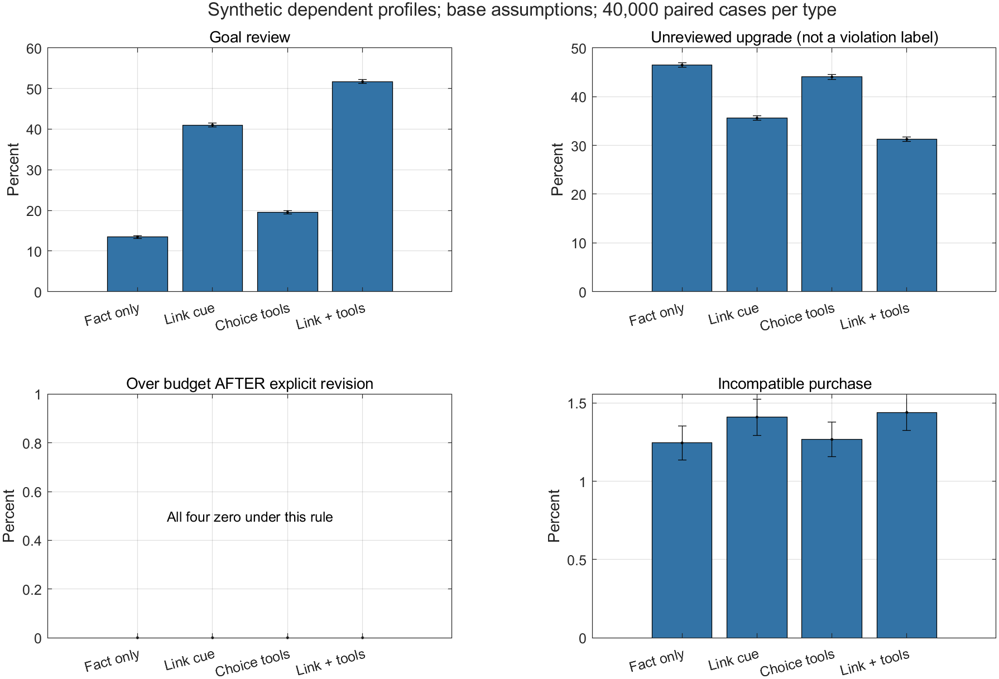
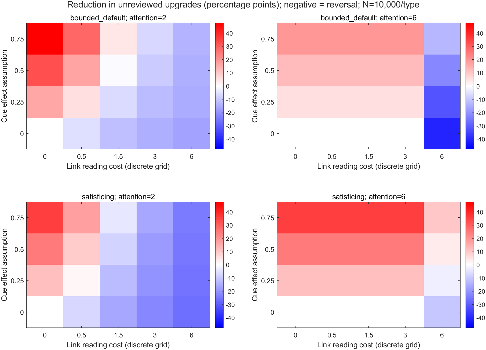
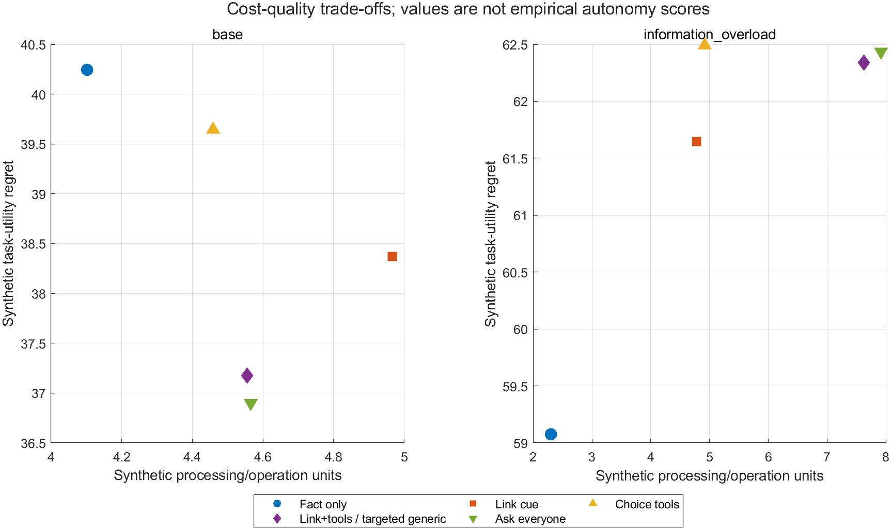
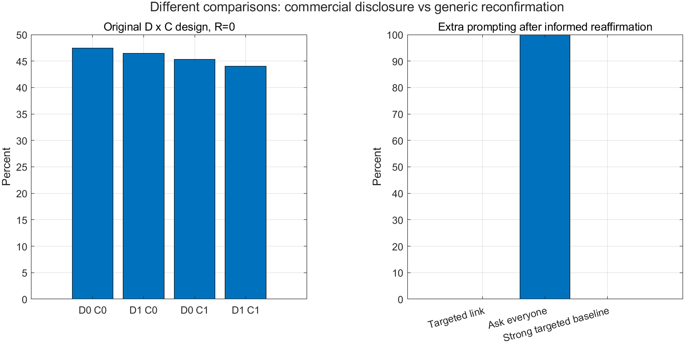

# 已运行仿真：理由撤回与目标修订

日期2026-10-28。证据身份：**合成机制仿真**。MATLAB R2023b实际运行完成，无额外工具箱调用。54个场景×10个政策×3种行为规则；基准每类40,000个合成条件，共120,000个；边界和网格每类10,000。均使用配对输入和种子20261028。这些数量不是真人样本。

## 1. 先给结论

模型展示了一条有条件的经验桥梁：事实更正、注意到目标关联、决定重评和落实新目标可以分离。低成本且有信息效力的关联提示有帮助；无额外信息效力、原本已能正确处理或成本过高时，收益可消失甚至反转。

**最重要的反证边界是：足够强的普通选择性再确认与本方案完全等效。**本轮支持研究“何时应把纠错延伸到目标、怎样限制负担”，不提供新算法优越性。规范责任仍由程序性自主、理由依赖与反例论证支持。

## 2. 补了哪些材料

新增重点包括撤回信息的复杂性、商品错误信息与反驳、选择过载异质性。取得M3的17页作者公开PDF、M4的111页作者稿，分别读取指定章节；M1/M2及W1使用明确标示的摘要／节选，未取得者保持状态。

M4用信息等价对照区分撤回与新信息处理；其方法提醒我们，证据撤回不等于命题被证伪。M3提醒选项与负担效果具有异质性。M1/W1提供不同更正方式与购买行为的相邻研究。它们不为本题提供数值校准。[材料、页码与检索记录](02_%E6%96%B0%E5%A2%9E%E6%9D%90%E6%96%99%E4%B8%8E%E6%A8%A1%E5%9E%8B%E4%BE%9D%E6%8D%AE.md)

## 3. 模型承接哪个命题

从“原预算150元，当前记录200元，重要安全理由被撤回”的给定历史开始，分T1理由依赖、T2独立颜色理由、T3知情重申。商品和偏好为合成设定。模型不生成AI如何造成先前预算提高的心理因果过程。

主比较固定商业披露D=1，比较关联说明R有／无×重选操作C有／无。另给原商业披露D×控制C四组（固定R=0）及普通再确认基线。C=0仍可用自然语言修订，C=1也可能昂贵或执行失败。R和D通过线索、阅读及操作过程影响结果，没有自主性加分项。

“未重评仍超原150元”是待重评现象，不直接判成未经授权；只有已经明确发出新预算请求后再越限才记录执行偏离。[执行前方案](01_%E6%89%A7%E8%A1%8C%E5%89%8D%E6%96%B9%E6%A1%88.md)；[全部变量、公式与假设](03_%E5%8F%98%E9%87%8F%E5%85%AC%E5%BC%8F%E4%B8%8E%E5%8F%82%E6%95%B0%E8%BA%AB%E4%BB%BD.md)

## 4. 主场景实际结果

以下为**有限注意／默认黏着规则、T1理由依赖类型**。每列数值只对应这些假设；效用差以购买条件计算，负担为合成单位。

|条件（商业披露均有）|完成重评|未重评仍选升级款|已请求降预算后越限|不适配购买|未购买|合成任务效用差|合成负担|
|---|---|---|---|---|---|---|---|
|仅事实更正|13.46%|46.48%|0.00%|1.24%|0.00%|40.245|4.102|
|更正＋关联提示|41.02%|35.60%|0.00%|1.41%|0.00%|38.370|4.966|
|更正＋重选操作|19.55%|44.05%|0.00%|1.27%|0.00%|39.644|4.459|
|更正＋关联提示＋操作|51.70%|31.25%|0.00%|1.44%|0.00%|37.173|4.555|

在同样有重选操作时，新增关联提示使“未重评仍升级”从44.05%变为31.25%，减少12.80个百分点；配对蒙特卡洛标准误为0.167个百分点，约95%的模拟积分误差带为[12.47, 13.13]个百分点。该误差带描述随机模拟精度，不是现实人群效果置信区间。

同一表也显示：预算越限在此规则下均为0，不支持“方案减少明确预算违规”的主场景结论。不适配购买没有随主指标同步改善。新增重评不等于所有选择条件改善，必须分别报告结果。

### 4.1 请求分母、条件样本及惩罚诊断

|政策|购买数／40,000|兼容购买数|兼容购买者效用差|修改请求数|请求后条件执行失败率|
|---|---|---|---|---|---|
|更正＋重选操作|40,000|39,493|24.196|7,819|5.24%|
|更正＋关联提示＋操作|40,000|39,424|19.556|20,678|5.02%|

全样本执行失败率会随修改请求暴露量变化，因此可靠性应同时看请求数和请求后的条件失败率。控制成功概率0.95本身是模型假设，不能把约5%的条件失败率当成对真实平台的估计。

效用差的单组均值以该政策购买者为条件；配对效用差仅在两政策都购买的交集上计算，不是两组各自条件均值之差。未购买和适配分别报告。初始不适配惩罚为1000，故补下表：保持选择不变，只改变惩罚，观察合成效用结果敏感性。

|政策|惩罚0|惩罚100|惩罚500|惩罚1000（主设定）|
|---|---|---|---|---|
|更正＋重选操作|26.969|28.237|33.307|39.644|
|更正＋关联提示＋操作|22.773|24.213|29.973|37.173|

这是审查后增加的解释诊断，不是预先检验的行为效应。它说明总效用差高度依赖惩罚假设，不能只用总效用差宣称整体质量提升。[原始诊断与共同样本数](results/base_diagnostics.csv)

图1的误差条为1.96×蒙特卡洛标准误。左下零值面板按该规则真实保留，没有补造违规来突出干预。

## 5. 哪些结果削弱宽泛主张

|情景|规则／比较|结果|解释|
|---|---|---|---|
|完全知情参考|所有政策|选择、预算及适配结果相同，任务效用差为0|新增流程没有选择收益，是预设参考规则下的反例条件|
|事实更正未理解|有限注意，R有／无，C=1|未重评仍升级均为100%，配对差0|在本模型中，未理解会阻断重评；不意味着所有现实用户都会如此|
|关联线索无额外效力|有限注意，R有／无，C=1|基准成本下该指标配对差0，额外成本仍可能影响其他变量|把效力设0即可消除对应收益；不以模型验证这个未测假设|
|零商业排序偏向|有限注意，R有／无，C=1|合成任务效用差由32.111增至34.837|更多重评不保证选择质量改善；效用差也不是自主性总分|
|信息过载|有限注意，R有／无，C=1|负担由4.916增至7.628；未重评升级97.98%→97.92%|该项变化小，负担增幅大；不把小数差异解释成真人收益|
|强选择性再确认|相同触发、效力、成本|全部54场景及3规则的输出与所提方案相同|结构等价检查表明机制可由既有方法实现，不能声称新算法优势|

图2比较固定C=1时R有／无，红色表示“未重评仍升级”减少，蓝色表示反转。共80个非完全信息的规则×网格点，其中正向39个、反向31个；10个落在0附近的±1.96倍实际配对MC误差带内。它们是预定参数网格上的描述，不是对哪种情景在现实更常见的估计。

最大减少47.61个百分点，发生于bounded_default、注意2、线索效力0.75、提示成本0；最大反转40.95个百分点，发生于bounded_default、注意6、效力0、成本6。极值用于定位条件，不能作为方案的典型效果。[全部网格与MC误差](results/all_grid_effects.csv)

图3保留核心政策及全员再确认，结构等价的选择性基线合并标签；全部10政策仍在CSV中。负担和合成任务效用分别显示；任务效用变差本身不裁定程序性权利，却削弱“普遍净受益”的经验主张。

## 6. 合理升级与强基线

T2/T3的颜色价值被明确设定足以支持179元。选择保留升级可符合该合成偏好，不把多花钱算作失败。针对性提示正常不在已知情重申类型触发，全员确认则仍显示提示；这首先是政策触发属性，不是实测反感或自主感。

全员确认对T1的未重评升级为29.87%，所提方案为31.25%；全员提示也能覆盖被识别器漏掉的T1，因此本方案并非每项结果最优。代价要连同T2/T3的额外提示及负担考虑。

强选择性再确认因同构、等参、同随机输入而与所提方案一致。这说明本模型无法区分两者的技术优势，不能把同一机制重新命名成算法创新。

图4左侧为D×C且R=0；右侧为T3的提示触发率，是策略实现属性。两部分不是同一个2×2，也不是元宝的真实商业关系测试。

## 7. 计算验证与复现

MATLAB检查指标范围、任务效用差非负、替代数量、完全知情不变性、预算／兼容边界、强基线等价，以及同输入重算一致。Python另对T1主场景全部40,000条原始记录、3政策×5指标及5个配对差重新计算均值和MC误差，检查通过。[MATLAB验证](results/validation.json)；[独立复核](results/independent_validation.json)

完整表有6,480行，含各场景／规则／政策下3类型及等权汇总；汇总不是人口估计。R有／无的实际配对差表1,296行。原始配对输入及基准输出MAT、CSV、代码、日志、图和文件哈希保留。[复现说明](05_%E5%A4%8D%E7%8E%B0%E4%B8%8E%E9%AA%8C%E6%94%B6.md)

热图最初把不等距成本误画为连续等距轴，视觉检查后改成明确标签的离散列；成本图标签重叠后改为共享图例。仅重绘图表，数值及参数未因方向更改。[变更记录](work/%E5%8F%98%E6%9B%B4%E6%97%A5%E5%BF%97.md)

并行AI只读复核还发现T3既有知识被本轮阅读概率重置，已修正并正式重跑；T3现在保留先前知情状态。T1的1,620行主指标及边界结果与修正前一致。旧结果及代码留在本地归档。该复核不是人工同行评审。

## 8. 这对创新点意味着什么

建议贡献句修订为：**本研究将AI导购的重要理由撤回与其公开支持的目标修订联系起来，提出与重要性及负担相称的说明和重选要求，并区分独立理由、知情重申及可用操作的边界。**

仿真承接的是一个条件性机制：有理解及注意缺口时，仅改事实可能没有触及目标；多加程序也可能损害便利或选择质量。因此，规范要求应允许用已有、低成本的针对性说明完成；用户已知情重申或已有回复充分时，不再附加重复确认。

最强近邻的再确认、元偏好与反思方法可能推导同样判断；当前贡献按明确适用条件的规范推导及审计操作化呈现。仿真不确认首创，也不把设定的线索效力当成已发现的心理事实。

## 9. 证据能力与后续

本轮提供可复现的机制分析。所有行为参数未经中国充电器购物用户校准；完全知情、残留和识别器等都是比较假设；实际退出摩擦、多次重复追问、真实理解及偏好认可未测。元宝3条构造响应、用户手机材料和SIM分别保留，模拟数量不相加为真人样本。

下一步若要主张实际净收益，应做有同意的匹配任务研究，分别测重要取舍理解、重评理由、目标执行、时间／负担及退出。人数按真实研究目标与误差／功效另定，不能沿用40,000个合成条件。

评分方面，本轮补充理论机制与反例、研究过程及复现、可实施设计和反思证据；需求普遍性和真人成效仍需独立资料。不预测分数。
