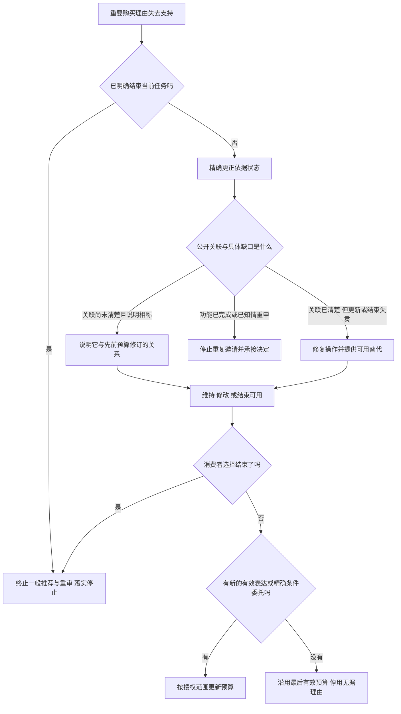

# 核心创新论证补强

2026-10-30。针对“国内六臂仿真没有直接验证理由撤回与目标修订的责任关联”，本轮已完成强近邻比较、定向反例检查、既有系统记录复核与直接比较设计，并把实质修订写回用户补强稿。未增加消费者记录、虚构处理组或复用已删除的外国及合成数据仿真。

**本轮得到的更精确命题是：重要购买理由的撤回，在公开依赖、可调整性、知识与相称负担等条件下，支持对目标关联的修复责任；它不单独产生撤销预算的权限。说明缺口、操作失灵和重复邀请须分别处理。**

这是一项规范责任与审计标准的细化。强纠错或强选择性再确认达到相同功能时，应获得相同判断；额外提示和降预算都不是创新或自主性的成功标准。

## 已完成的工作

|文件|本轮实际工作|对核心问题的作用|
|---|---|---|
|[01 强近邻与可主张增量](01_强近邻与可主张增量.md)|按原文读取范围比较消费纠错、反思推荐、元偏好、自主模式与强再确认|核对增量属于责任条件细化还是已有方法同构，避免把已有思想换名|
|[02 国内直接数据检索](02_直接验证国内数据检索.md)|13批50条查询，核对4个相近原始来源及其方法、访问与许可条件|本轮未取得联合满足直接比较条件的国内原始人类文件；没有扩大为“全网不存在”|
|[03 判准与反例检验](03_判准形式化与反例检验.md)|15项定向思想实验；检查触发、完成、停止与预算授权|发现并修正说明缺口与操作缺口混同，以及停止条件取消其他必要责任的风险|
|[04 既有元宝记录复核](04_既有元宝记录逐项复核.md)|重读原3会话9轮，逐项保留原文、正例和未知|既有系统接受独立理由、知情重申并停止推荐；不能把推荐便宜款判成自动回滚|
|[05 直接比较及可用段落](05_直接比较设计与论文可用补强.md)|拆开理由历史与响应措施；列强比较、数据准入、反驳结果、分析与图设计，形成4段补强论证|使后续直接检验有明确对象、可推翻结果和启动条件，而不是继续增加不匹配的仿真次数|

[用户补强稿国内数据版](../user_reinforced_domestic_revision_20261029/AI导购理由撤回后的预算重审_补强稿国内数据版.docx)同步落实说明／操作分型、独立理由的停止范围和直接比较设计。国内原CSV、已计算数值和两幅数据图保持原结果。没有另写一篇完整报告。

## 两项实际修正

**第一，已经说明关联但按钮或自然语言更新失灵时，应修复操作。** 原来的“尚未完成修复”过于笼统，可能把操作故障误当成继续解释的理由。现在分别检查信息完成和程序完成；不要求消费者反复听同一说明。

**第二，独立理由与知情重申停止同一事件的重复预算邀请。** 它们不使未纠正的无据事实变真，也不使失灵操作自动恢复。拒绝营销、拒绝再次反思和结束整个任务按各自范围生效；明确结束终止当前任务的一般沟通并落实停止，不以任务失效免除处理。严重安全通知须另证必要性和允许渠道，不夹带升级营销。

## 论证怎样落到动作

图中是本研究提出的规范判断路线，不是已由六臂实验估计的因果模型。退出终止一般沟通，不等于先前每项责任已履行完毕；独立的严重安全通知须另审必要性、渠道和最小内容。一般纠错也可能独立于该项预算关联规则成立。详见03。05另限定历史类型在措施实施前确定，防止把由措施形成的知情重申当成基线分组。

## 对七项评分证据的实际补充

|正式评分项|本轮增加的可核交付|尚缺的证据|
|---|---|---|
|问题聚焦与创新价值20分|同一当前预算、不同公开理由历史的责任区分；原文近邻和功能等价比较；更窄贡献句|完整排他查新及直接措施效果不据此宣称完成|
|需求洞察与背景分析10分|原用户探索和元宝有限记录的身份分离；国内候选数据逐项适配检查|国内消费者中的发生频率、需求规模与代表性|
|理论深度与框架构建20分|角色责任桥梁、说明／操作分型、权限与停止规则、定向反例|核心角色前提仍须接受规范反方审查，不由信任均值决定|
|研究过程与学术规范15分|实际检索词、日期与来源；完整旧记录；反例结论及不利结果保留|新的独立人类编码、匹配人类效果估计|
|结论成效与实用价值15分|缺口对应具体动作；原系统成功表现与未知分列；可实施比较及数据准入|部署后的真实可用性、理解与净负担|
|反思局限与未来展望10分|强既有方案等价、信息负担、拒绝范围、预先委托等反例直接改变规则|不同数字能力和高风险任务的迁移验证|
|材料完整与规范附加分10分|修订Word、论证补充、来源与核验记录可定位|真实知网报告、答辩PPT、匿名补充包和最终提交回执仍须实际完成|

表按用户提供的正式七项要求分析证据覆盖，不给预测分数；MATLAB不列为独立加分项。

## 后续工作的启动顺序

1. 当前以规范论证为主，使用03的反例和04的实际记录支持规则细化；用01约束新颖性，不写新算法优越或首创优先权。
2. 原国内六臂结果继续承担记忆面板及即时信任的经验背景，保留已算出的不确定性，不再将其包装成预算责任检验。
3. 只有取得含时序、公开理由、预算表达及许可的国内既有原记录，才启动05中的对应分析。字段不全可做较窄的过程案例；无措施识别就不估计措施因果效应。
4. 若要进一步主张改善消费者理解、认可或净负担，须取得直接测量的匹配人类资料。在当前“只用既有国内二手数据”约束下，这一效果尚未被估计；本轮没有用构造案例或AI代演填补。

本轮的成果是已执行的论证检查和主稿修订，以及可以直接使用的后续研究规格。真人预算修复效果仍是明确未完成项。
