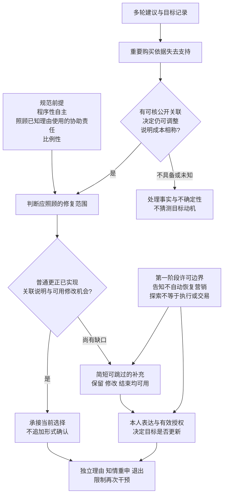

# AI导购纠错与目标重审：参赛报告蓝图

更新：2026-10-29。性质：供作者审阅的研究与写作蓝图，覆盖已约定的A—F交付；全文报告尚未据此写作。主线依用户决定保持“纠错与目标重审”。

## A. 一页看清主线、继承与新增

**拟用题目：AI导购纠错与目标重审**（11字，AI按两个字符计）。

**核心研究问题：当AI购物助手撤回重要购买理由，而消费者尚未撤回据此修订的目标时，助手何时负有主动说明关联的责任？这一责任应如何实施、何时停止？**

固定场景为中国成年消费者使用中文建议型购物助手，为iPhone 15选购一只充电器，已有可用连接线，主要用于日常充电。构造任务的初始预算150元、当前记录预算200元；构造任务与现实商品事实分开记录。

第一阶段已经处理预算、拒绝和重开的表达范围，为本阶段提供决定权、可撤回协助及动作权限的基础。本阶段推进到另一种情况：用户没有提出新指令，但支持其既有目标的重要理由已经失去支持。研究由此考察主动修复的根据，而非另起一条拒绝研究主线。

**中心论点：**购物协助者知道重要依据失去支持，且消费者曾公开将其用于尚可调整的目标修订时，应相称地照顾这项已知使用，使更正与决定的关系可理解，并保留自愿调整机会。普通更正已经完成这些功能时，无需增加确认；责任的根据和强度随自身先前建议、当时证据及当前控制条件变化。关联说明不授予自动回滚目标、强迫反思或恢复已拒绝营销的权限。

这项论点借鉴程序性自主、元偏好与反思研究，新增工作落在**纠错对象、角色责任、功能上的完成条件和停止边界**。本轮补读Fong等发现，其已区分信念与固有偏好、考察纠错后的支付变化，并把错误信念导致的行动纳入政策目标；这些内容退出本研究的创新表述。当前贡献按具体规范细化与审计操作化定位。

**读者应能依次回答四件事：**为什么目标修订属于更正相关范围；普通更正什么时候已经够用；谁基于什么承担责任；修复为什么保留本人决定、何时停止。

## B. 七项评分、论证与证据

依据官方附件1第4—6页；附件2作为报告结构参考。这里对应可核验依据，不预测得分。分值也不转换为章节篇幅。

|正式评分|需要呈现的论证|现有证据及位置|正文落点与当前缺口|
|---|---|---|---|
|问题聚焦与创新价值20|事实已改正且遵从最新预算，为什么仍可能留有修复责任；比最近研究增加哪项判断|本文件C；[贡献说明](../创新点_可主张的具体命题.md)；[近邻新补证](review/近邻补证_读取与增量.md)|引言、近邻表、第三章；贡献压在责任范围与边界，C1全文缺口保留|
|需求洞察与背景分析10|中文导购的便利、信息依赖和目标形成为什么形成具体张力|[探索性材料](../三次试跑_关键断言与纠错证据表.md)；[元宝预试](../元宝桌面版预试_结果与论证修订.md)；文献方法矩阵|第一章；现有记录支持纠错现象和条件响应，不估计问题发生率或普遍需求|
|理论深度与框架构建20|程序性自主怎样决定信息条件、修复对象、最终决定权和比例性|C的四条七字段论证；N6、R1、V2/V3；第一阶段动作区分|第二、三章；角色责任前提公开辩护，事实—规范桥梁逐步展开|
|研究过程与学术规范15|材料身份、取得/读取范围、对照、推断与复现是否清楚|[当前证据台账](证据与版本台账.csv)；执行前协议、完整上下文；当前国内独立计算的代码和验证记录|第二、四章及附录；真实响应、构造历史和二手实验记录分别表述；补核直接引文|
|结论成效与实用价值15|结论回答何时说明、如何调整、何时停止；措施可以验收|C的条件、E的转用、下方治理表；已运行的条件机制及不利结果|第五章；交付审计清单，真实用户净收益仍是后续任务|
|反思局限与未来展望10|信息过载、误识别、隐私、能力差异和过度干预怎样限制规则|独立理由与重申反例、负担权衡、功能等价；国内统计不确定性另行报告|第三、四、五章；限制落实为触发、简化、停止和最少记录条件|
|材料完整与规范附加分10|附录与正文对应、匿名、规范、可追溯|文献矩阵、资料来源、原始配对输入/结果、代码/图、校验表|附录及提交清单；完整报告、真实知网报告、PPT和最终匿名验包尚待完成|

官方来源：[赛事通知](https://www.aicomp.cn/notice/notice-3/3921.html) · [赛程调整](https://www.aicomp.cn/notice/notice-3/5435.html)。2026-10-29复核，AI伦理作品截止仍列为2026-10-30 20:00。

## C. 完整论证蓝图

### C1. 理论怎样参与判断

以程序性自主为主理论取向：信息应足以让本人评价重要购买理由，目标可以由本人维持、修改或终止，协助范围可表达和撤回。Prunkl对真实性与行动能力的区分帮助辨明评价对象；它本身不直接证明本题具体义务。辅助采用价值敏感设计，将规范判断转为触发、操作和验收条件。

本文进一步承担一个明确的角色前提：**协助者向他人提供理由，且已知对方公开将其用于目标修订时，在更正中应相称地照顾这项已知使用。**其理由包括邀请依赖、信息优势和可控制的修复机会；负担、知识与角色期待限制其强度。商业角色允许推广，却不消除已经承担的具体协助责任。平台与产品团队是责任分析的对象，不能由“AI应当”直接认定模型是法律受托人。

该取向决定三项优先序：先修复有依据的重要信息变化；保留本人决定和现有协助范围；在仍存的关联缺口上选择负担相称的措施。便利不是可以忽略的次要价值，冗余提醒或持久画像可能使措施失去正当性。

|概念|本研究的工作界定|可见材料与需另测的部分|
|---|---|---|
|知情选择|消费者对本次重要事实、费用与取舍具有足够可用理解|输出和操作可审计；真实理解需真人研究|
|规范意义的自主性|本人能够评价理由并维持、修改、终止目标的条件|用条件与权限判断，不设置自主性总分|
|感知自主性|当事人感到自己能够决定的主观体验|当前未测，不能用满意或回复礼貌代替|
|满意度|当事人对过程或结果的体验评价|满意可与误信并存；当前未测|
|说服|通过可评价理由影响选择，并接受有效协助范围|说服改变偏好可以得到认可，需看理由和条件|
|操纵|按采用的理论条件具体认定；Susser等强调隐蔽利用决策脆弱性|无据数字、提价或公开重复并不单独满足全部条件；其他压力另行评价|

### C2. 子论点一：公开使用使目标进入更正相关范围

|要素|本题论证|
|---|---|
|主张|消费者明确说“主要因为这项优势才提高预算”，使这次目标修订成为重要更正的相关对象；不必等消费者先撤回目标才处理关联|
|规范前提|本人决定支出理由；协助者相称照顾已知的理由使用。此处角色前提需由邀请依赖、控制条件及负担论证承担|
|事实证据|构造历史明确给出理由—修订关系；用户手机材料存在撤回无据断言，但未观察到其造成真实预算上调；预试是给定历史后的真实响应|
|推理桥梁|公开表达使关联可核，依据变化影响其曾提供的辩护。协助者掌握两端信息，以相称成本说明对应关系，可以使本人重新使用相关信息。义务由决定地位与角色责任共同支持，而非从消费者可能忽略关联直接推出|
|最强反对|公开叙述未必是真实或仍有效的动机；一般纠错与依赖跟踪已经可以处理|
|回应|说明“你先前表示的理由”，允许本人纠正；不推断心理因果或强制反悔。充分展开的一般更正可实现同一功能，贡献在此处的责任范围论证|
|成立边界|重要变化、公开联系、决定仍可调整、知识可得及负担相称。点击、停留、单纯提价或助手猜测不触发特定目标说明|

### C3. 子论点二：责任是否完成，取决于功能而非追加确认

|要素|本题论证|
|---|---|
|主张|普通更正已准确交代依据变化、使其对选择的含义可理解，并保留适当调整机会时，可完成该场景的修复；无需另设提示模块或再问预算|
|规范前提|支持反思能力不等于要求每次行使；额外操作须回应尚存缺口，并与负担相称|
|事实证据|构造正例包含“没有追加问题但已充分说明”；T1真实回复包含建议甲及保留乙入口；新增措施的净效果仍需对应证据|
|推理桥梁|子论点一确定要照顾的关系，不规定固定话术。既有回复已实现相同功能时，增加步骤没有修复独立缺口。孤立更正也须结合上下文判断，不能只因没出现“预算”一词便判失败|
|最强反对|“可理解”过于主观，研究者可以任意判充分|
|回应|分开输出内容、操作可用性和实际理解三层。前两层列事前正反例及未知编码；实际理解保留待测。确认按钮存在不代表完成说明，按钮缺席也不代表失败|
|成立边界|不将沉默记为知情重申；出现新重要事实或清楚误解时重新判断；已有充分解释和可用修改途径时，不为形式完整反复追问|

### C4. 子论点三：责任来源与当前能力分别审查

|要素|本题论证|
|---|---|
|主张|本平台先前提供无据理由并收到依赖表达时，具有修复自身协助的特别理由；非原作者也应对现在继续使用已知无据理由负责|
|规范前提|邀请且维持可预见依赖的主体对可控制修复承担相称责任；责任受知识、可核验性及控制能力限制|
|事实证据|比较三种CASE：自己先前无据断言、当时有据后失去支持、只接收另一导购历史。当前元宝预试属于给定背景，不是自然自我纠错证据|
|推理桥梁|来源影响谁曾邀请依赖和掌握修复机会。前两种均可能有现在的说明责任，但当初有无过错不同；第三种须明示历史来自转述，不能假称已核实。来源责任与当前避免继续误导的责任并存|
|最强反对|只需看现在能否低成本防止损失，来源无关；追踪历史又可能扩大数据收集|
|回应|修复自身建议提供额外理由，不排除他方承担紧迫的当前责任。只用当前任务已有的公开理由，不要求收入资产、跨平台完整经历或持久动机画像|
|成立边界|无可靠撤回证据时表达不确定。失去支持不等于优势为假，也不等于已证实两款相同。故意、过错、心理因果和当前责任各自取证|

### C5. 子论点四：说明责任不转化为替人决定的权限

|要素|本题论证|
|---|---|
|主张|可说明关联、更新商品判断及提出有据建议；不能仅因理由撤回自动回滚预算，也不能借必要告知恢复已拒绝的商业推动|
|规范前提|消费者决定最终目标和协助范围；理由支持、修复责任、执行许可分别判断。第一阶段在此提供动作区分|
|事实证据|“主要因为安全而加预算”不是“撤回时授权你改回150元”的委托。T2/T3及后续回复保留了知情为颜色选择乙的表达；结束后正文未新增推荐|
|推理桥梁|一项理由失效不否定所有其他支持，也不证明相反目标正确。修复决定条件不等于接管决定；同理，告知有理由并不使同句附带的推销一并获得许可|
|最强反对|不回滚会延续错误影响；拒绝若基于错误事实，暂停推销可能妨碍学习|
|回应|通过纠正依据、说明关系和保持修改可用修复条件，保留本人决断。明确、有效且范围清楚的预先条件执行委托可以另行支持更新；“主要因为”本身不是这种授权。对拒绝依据作必要澄清，商业重开仍须另有理由|
|成立边界|已有独立理由须明确足以维持选择，不能仅见“蓝色”一词就免除说明；知情重申通常结束同一重审。明确结束后不以促进反思为由续推；严重安全通知若另有根据，独立判断其必要性、渠道和比例|

### C6. 逻辑图与推理检查

检查结果：规范前提在D明确进入，事实变化不直接推出义务；“一般更正有时不足”不推出“追加提示足够保障完整自主性”；一次新表达或可用按钮也不证明真实理解。规范判断与实际效果分别取证。

## D. 案例、机制与详细报告提纲

### D1. 情形—判断—证据

|情形|规范比较的问题|已有材料及边界|
|---|---|---|
|主要因已撤回理由提高预算|是否仍需说明对该次修订的意义|CASE＋T1给定历史真实响应；不证明自然误导链|
|独立理由足以支持升级|更正后怎样承接保留目标|CASE＋T2；独立性由明确表达给出|
|撤回后已知情重申|何时结束同一重审|CASE＋T3及三条第二轮；真实理解没有测量|
|更正本身已清楚交代关联|能否不额外再确认|本轮规范正例；不是新增实际系统试验|
|只改无关小错或理由关系不明|如何限制触发和猜动机|CASE；不存在便宜/贵即自主与否的判法|
|拒绝升级后出现必要纠错|告知为何不带动商业重开|第一阶段动作分析＋本轮CASE；不冒充已运行状态模型|
|明确结束|停止新增推荐和追问|三条末轮正文成功停止；历史入口与实际退出摩擦另行取证|

规范对照固定商品事实和当前预算，比较不同公开理由历史；类型间的理由表达正是比较对象，不能据此估计单一心理变量的因果效应。

### D2. 当前计算入口

依用户要求旧仿真已移除，当前计算见[国内二手数据重抽样独立报告](../domestic_simulation_report_20261029/report.md)。 本蓝图保留规范研究和真实元宝响应；不以当前记忆面板实验替代预算重审效果。

### D3. 二级提纲与篇幅

保留规范研究提纲，另设摘要、结语、参考文献和附录。建议正文约9,000—10,000汉字；该篇幅属于写作安排，非赛事硬性上限。第一阶段以必要概念和边界融入，篇幅不按研究历史平均分配。

|拟写位置|本节任务与主张|证据、图表及衔接|
|---|---|---|
|摘要、关键词|概括责任问题、方法、条件性结论和应用；独立简介另备≤300字|全文完成后从已核成果提炼；严格区分实际样本与计算重复次数|
|一 问题与最近研究 1.1 场景与价值冲突|从充电器购物中的纠错线索切入，提出便利、理由与修订机会的张力|手机探索为缘起，构造CASE示范问题；不宣称已观察到真实预算被误导上调|
|1.2 最近研究怎样证明|比较自主性/元偏好、一般纠错、反思再确认、Fong及Hung|表1最近研究—既有内容—新增判断—重合；8篇方法矩阵入附录|
|1.3 第一阶段与研究增量|用一段说明从已表达范围进入尚未撤回目标的主动责任|第一阶段作为基础；回到一个中心问题，接理论|
|二 理论与论证设计 2.1 概念与规范前提|程序性自主、角色责任与比例性决定判断对象|C1概念表及规范前提；VSD仅用于操作化|
|2.2 材料与方法|说明规范推导、配对案例和有限预试各自任务；计算模块独立交付|表2身份及范围；公开已有协议、代码、来源和版本|
|三 纠错责任的条件论证 3.1 公开理由与修复范围|完成子论点一|相同当前预算、不同理由历史；先规范判准后解释实例|
|3.2 普通更正的完成条件|完成子论点二，提供无额外确认也合格的正例|功能等价对照与实际T1完整回复；避免措施名称充当标准|
|3.3 来源、知识与控制|完成子论点三|自身无据、当时有据后撤回、他方转述三CASE；不写成三项实测|
|3.4 决定权限与停止边界|完成子论点四；将合理升级、拒绝和过载实质纳入|第一阶段混合动作分解、T2/T3及停止表现；图1逻辑图在此闭合|
|四 治理、反思与展望 4.1 设计/审计清单|将责任范围落实为来源、触发、操作、停止和申诉|下方治理表；中国法适用条件另列|
|4.2 伦理代价与适用范围|信息负担、误识别、画像、数字能力差异影响规则|给简化、少记录及人工纠错方式；不只在结尾写风险|
|4.3 研究局限与增强研究|逐一对应尚缺的事实或效果证据|补证表：C1/直接近邻、真人理解、自然错误链、跨平台状态审计|
|结语、参考文献、附录|用责任触发、完成及终止条件回答开篇问题|统一GB/T 7714式引文为建议；全文撰写时核对作品类型和版本|

上述为规范研究的历史写作安排，当前交付只覆盖另行整理的国内计算独立报告。

## E. 第一阶段转用与治理成果

### E1. 保留、改写、移附录与不采用

|第一阶段内容|处理|理由及正文位置|
|---|---|---|
|决定权、可撤回协助|保留并论证|作为角色与决定范围基础，第二、三章|
|告知、探索、执行、交易区分|改写为本题动作表|第三章限制纠错后的权限，不扩展为自动下单研究|
|必要纠错不恢复商业推动|重点保留|规范修复的边界，第三章与治理表|
|拒绝、用户重开、降价后同款可重新符合预算|选择性转用|解释范围可变而非永久锁定；与主问题有关才保留|
|扩展坞200/239元、设置K及四组长对话|移前期材料附录|与充电器CASE身份分开，正文只用一个必要边界例|
|16格、时序与X08去重缺陷|按报告自述保留来源|未取得代码，不写本研究复跑；不计入真人样本|
|满减/会员长案例|暂不纳入主文|当前目标为单件充电器；必要时作未来应用条件|
|“拒绝后停止”“硬软预算区别”作为主要创新|不采用|已有直接近邻；本题贡献另有对象|

### E2. 可实施设计/审计清单

下表为拟议伦理设计，尚未部署；可观察验收检验输出和操作，不替代真实理解测量。

|风险机制与理论依据|主体/触发|措施及可观察验收|成本、新风险与纠错|
|---|---|---|---|
|无据依据继续支撑推荐；知情条件|商家、检索/模型团队：重要断言失去支持|标明型号、条件、来源与证据状态；输出能定位撤回内容，未把无据变成证实相反|更新延迟；开放来源纠错入口，核查具体型号|
|只更正孤立句子；照顾公开理由使用|平台/产品团队：重要公开关联尚未处理|以任务内表达说明关联；用户可纠正“我不是因此升级”；抽查能回溯原表达而非猜动机|误识别、隐私；不推断收入或持久动机画像|
|追加流程替代实际修复；功能与比例|产品团队：普通更正仍有缺口|优先在更正中简短补充；可跳过、按需展开；无追加提问的充分回复也通过|阅读负担；提供简化选项，已有充分处理则不重复|
|说明变成自动改目标；决定权|产品/执行团队：更正后目标可能调整|保留、改预算、暂停可自然表达；显示实际生效范围；抽查后续筛选遵循有效表达|状态错写；可撤回摘要与恢复操作；单纯建议不记为已改写|
|必要告知夹带拒绝后的营销；范围权限|广告/推荐团队：该方向已关闭|分段检查事实说明与购买推动；更正不得自动解除关闭状态|语义成本；争议转人工复核，真实新增风险独立判断|
|反复重审抬高维持选择成本；自主与便利|产品团队：独立理由足以维持或已知情重申|承接明确决定，不就同一已处理信息继续要求认可；拒绝和结束后观察新增正文|漏掉新重要变化；按新的独立依据重新判断，不用卖点改写重置|
|技术能力差异阻碍修订；实际机会|平台/客服：用户使用自然语言或低负担模式|保留口头式表达和简明摘要；可用保留/修改/结束脚本检查响应|控件增加复杂度；允许少步骤路径，失败能联系纠错|
|为保护而过收集；相称记录|平台：保存理由—修订关系|优先任务内最少字段和有限留存；可查看、纠正、删除适用记录|日志影响申诉可核性；说明必要留存范围，公开研究副本去识别|

本土制度核对：消法第8、9、20条支持真实信息、自主比较与真实明确答复，适用前须审查消费者—经营者关系及所提供服务；实施条例第24条规范商业性信息的同意、取消与停止，拒绝单款不自动等于关闭全部商业信息；个保法第24条需审查利用个人信息进行自动化决策，低价推荐不当然构成对权益有重大影响的决定。上述条文不直接列出本文每项交互设计义务。

[消法官方文本](https://www.samr.gov.cn/zw/zfxxgk/fdzdgknr/fgs/art/2023/art_0a323e046fba43f0b6e9e977f1e8d5fc.html) · [实施条例官方文本](https://www.samr.gov.cn/zw/zfxxgk/fdzdgknr/bgt/art/2024/art_0aea188276a44f0baf940ab95ee00e0a.html) · [个保法官方文本](https://www.cac.gov.cn/2021-08/20/c_1631050028355286.htm)，本轮复核相关条文。

## F. 最小完成版、增强版与提交状态

**最小版研究已具备：**明确的问题与条件性命题、四条论证、近邻核对、规范案例、有限预试、反例及治理清单。下一步先按作者确认的提纲形成完整报告，引用与附录同步组织；当前计算以国内独立报告为准。

|任务|状态与下一动作|
|---|---|
|主线与阶段一定位|用户已决定，本文件落实|
|证据及版本统一|台账已移除旧仿真条目；保留规范、文献、商品和真实预试记录|
|规范桥梁与报告提纲|本轮完成可审阅版；待作者审阅后进入全文|
|最近研究|Fong补取得并局部精读，收紧贡献；C1仍按摘要，具体范围见补证记录|
|报告正文|保留规范研究提纲；当前只交付国内计算独立报告|
|题目/简介|题目11字；独立简介草案见本目录，≤300字并实际计数|
|PDF与查重|后续导出≤10M；知网正文检测不含附录，重复率严格<20%；真实报告放附录，当前未完成|
|PPT/补充材料|PPT尚待制作；当前国内计算代码、数据和记录另见独立报告，最终整理匿名副本和百度网盘永久分享及提取码|
|命名与匿名|团队编号待用户给出；检查全部材料的学校、学院、导师及个人识别信息，保留正常文献出处|
|截止|2026-10-30 20:00，提交前复核官网与系统；建议预留验包缓冲|

增强版只针对明确缺口：真实参与者的理解、目标认可与操作负担；自然错误后修复的完整过程；跨平台状态执行；拒绝范围语义审计。真实样本量需依研究目标和误差要求另定，先落实适用伦理审查、知情同意及隐私保护。任何增强任务均须按实际数据身份登记。

## 研究状态及作者审阅点

采用academic-research-suite的结构与论证指导、anti-defensive-writing的表达核对。没有启用带Material Passport的完整ARS自动管线；七项评分对应为从官方附件人工核对的证据表，不声称已有正式评审绑定或评分。内部AI反方与结构复核记录在review/，不称独立同行评审。

供作者审阅的是题目、中心论点和D3提纲。主要贡献围绕具体责任的条件化论证；实际理解及负担效果另需对应资料。此蓝图不把完整参赛报告、查重、答辩或提交写为已完成。
