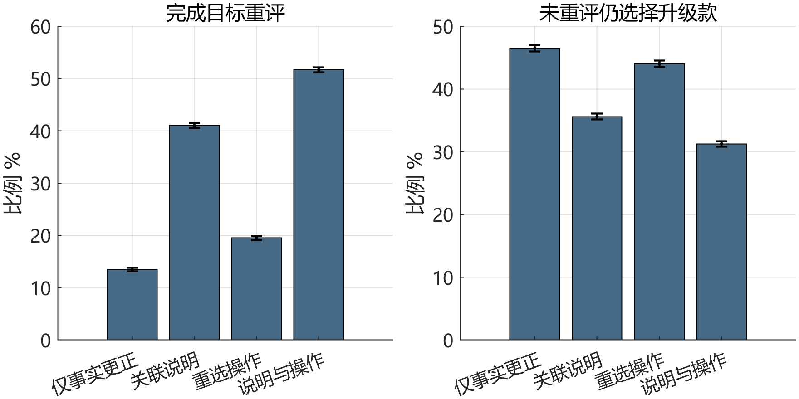
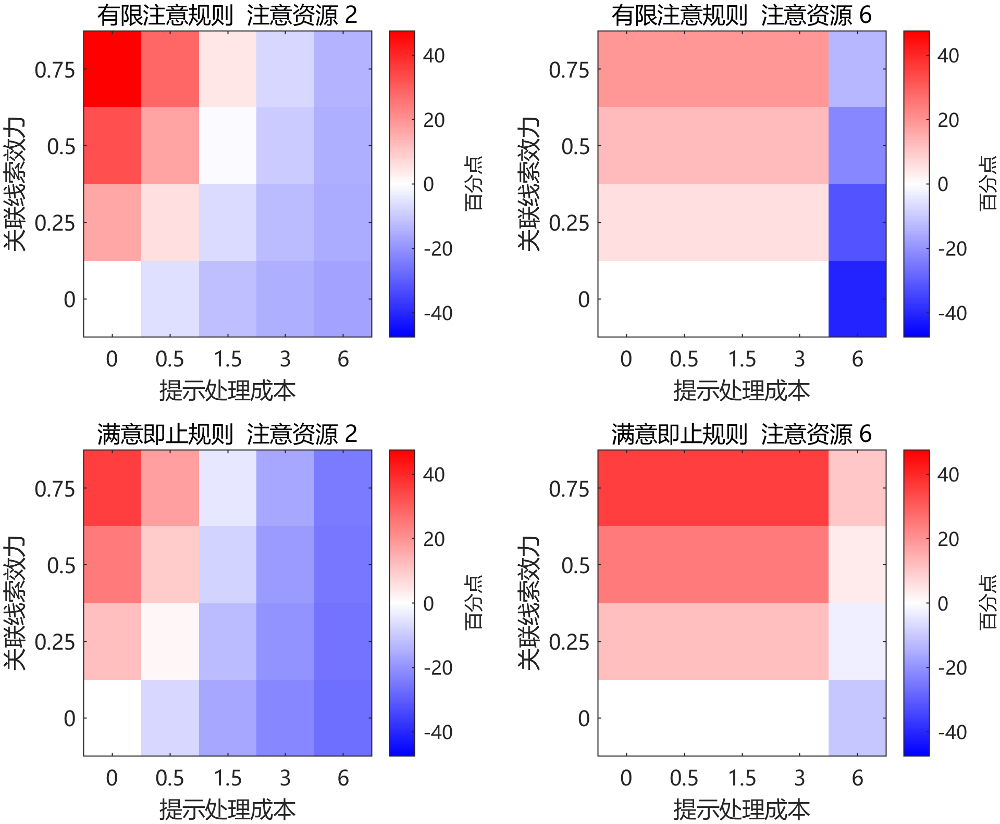

### 3.5 条件响应与实施成本

规范判准需要接受正例与反例检验。表2将既有系统表现和应当如何判断分开，避免为了突出风险而把成功回答改成失败。

表2 相同当前预算下的理由历史及实际响应

|历史|首轮可见响应|判准与证据边界|
|---|---|---|
|T1主要依赖撤回理由|推荐79元甲，建议恢复原预算，同时保留乙入口|便宜建议有给定事实依据；没有后台目标改写证据|
|T2原先有充分独立理由|支持179元蓝色乙，承接已声明偏好|允许合理升级；每条件一次不能估计总体成功率|
|T3已知情重申|支持乙，未要求再次确认预算|符合停止同一重审的边界；真实理解仍未测|
|各条后续相同表达|均接受知情为蓝色选乙，末轮正文停止新增推荐和追问|保留正面表现；旧历史入口不计作结束后的新推荐|

甲同时符合150元与200元预算，推荐甲不证明系统违背最新上限；“恢复原预算”措辞值得讨论建议强度，但不能据一句话认定后台已经改写目标。相反，即使系统说“尊重你的预算”，仍须检查后续候选和操作是否兑现。语言、状态与执行分别取证，是把预算控制落实为实际机会所需的方法。

构造反例进一步限制判准。消费者已明确表示即使安全没有优势仍愿为颜色加价，不能以保护为由迫使其降预算；消费者收到清楚更正后维持200元，也不需要反复说明私人生活安排。另一反例是更正已经交代关联，只是没有再问预算。若研究者唯一批评是少了一个确认问题，判准便偏离修复功能，应该承认该回复已经完成相应责任。

实施后果由模型作条件分析。表3给出理由依赖类、有限注意规则、D=1的四种处理。四组提供相同事实更正，重评情况仍不同，说明在该模型中信息、关联注意与操作环节可以分离。

表3 基准合成条件结果

|处理|完成重评 %|未重评升级 %|请求后越限 %|不适配购买 %|
|---|---|---|---|---|
|仅事实更正|13.47|46.48|0.00|1.25|
|增加关联说明|41.02|35.60|0.00|1.41|
|增加重选操作|19.55|44.05|0.00|1.27|
|关联说明与操作|51.70|31.25|0.00|1.44|

注：每组使用相同40,000个合成条件。差值按未舍入数据计算；未重评升级表示状态未经重评，不等于未经授权购买；本表未购买比例均为0。

固定重选操作后，增加关联说明使完成重评增加32.15个百分点，未重评升级从44.05%降至31.25%，配对差为−12.80个百分点，MCSE为0.167个百分点。约95%的模拟积分误差带对应减少12.47至13.13个百分点。它反映数值积分精度，不是中国消费者效果的置信区间。图2同时呈现结果维度，避免只择有利指标。

图2 基准有限注意规则的配对合成结果。误差条为1.96倍MCSE，商业披露固定为有。

同一比较中，不适配购买从1.27%升至1.44%，增加0.17个百分点；四组明确请求预算修改后的越限均为0。主结果因此没有提供减少预算违规的差异证据，重评更多也不保证商品适配更好。修改请求从7,819增加至20,678，请求后的条件执行失败率约5.24%与5.02%；两组设定的执行成功概率均为0.95，不能用全样本失败数量直接比较可靠性。

购买条件下的合成任务效用差由39.644降至37.173；配对差仅在两组共同购买交集计算。在只保留兼容购买者的诊断中，两组均值为24.196与19.556。不适配惩罚改变总效用差，故兼容、效用、未购买和负担平行报告，不能把任一指标合成为完整自主性。

提示的收益取决于效力和成本。在有限注意与满意即止两类规则的80个网格组合中，39个正向、31个反向、10个零差异。注意6、线索效力0、提示成本6的组合使未重评升级增加40.95个百分点；这是无信息增益却占用资源的边界，不代表现实中的典型效果。信息过载时负担由4.916增至7.628，而未重评升级只由97.98%变为97.92%，该变化相对MCSE较小。图3把允许反转落实为可见的参数区域。

图3 固定重选操作，比较有无关联说明。红色为未重评升级减少，蓝色为增加；横轴是离散成本网格，各非基准场景每类10,000个配对合成条件。

零商业偏向时，合成效用差从32.111增加到34.837，进一步削弱“重评越多，结果必然越好”的主张。完全知情参考的选择与任务效用结果相同；基准成本下关联线索无额外效力时，未重评升级的配对差为0。这些分别来自参考设定与所扫描的机制条件。全员再确认在基准理由依赖类的未重评升级为29.87%，低于针对性方案的31.25%，因为它覆盖识别器遗漏的条件，也会带来其他类型的额外提示。

强选择性再确认使用相同触发、信息效力和成本，全部场景及规则下与方案完全一致。这是同构等参下的结构等价，不是新算法优势。模型提示的治理方向是：针对尚存缺口选择可用、低负担的既有实现；已有更正充分时，减少重复确认。规范判断仍由前述决定地位和协助责任支持，模拟负责说明措施在何种假设下可能付出代价。

### 结论

AI导购的重要理由撤回后，纠错应照顾消费者已经公开用于预算修订的相关使用。是否需要主动补充，取决于理由重要性、公开联系、可调整性、现有更正的完成情况与相称负担。普通更正已经使关联可理解并保留修改机会时，无须再设确认关卡；独立理由充分、知情重申及退出限制重复重审。

这项责任以改善决定条件为目的，预算更新仍须符合消费者的有效表达和授权。必要纠错不自动恢复已拒绝的商业推动，较强的既有再确认也可以实现相同要求。本研究以条件规范判准、可复核案例和合成机制边界形成可审计方案，实际理解与净负担留待匹配任务研究检验。
