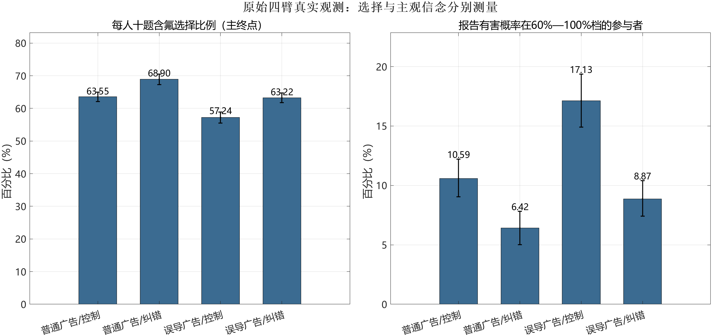
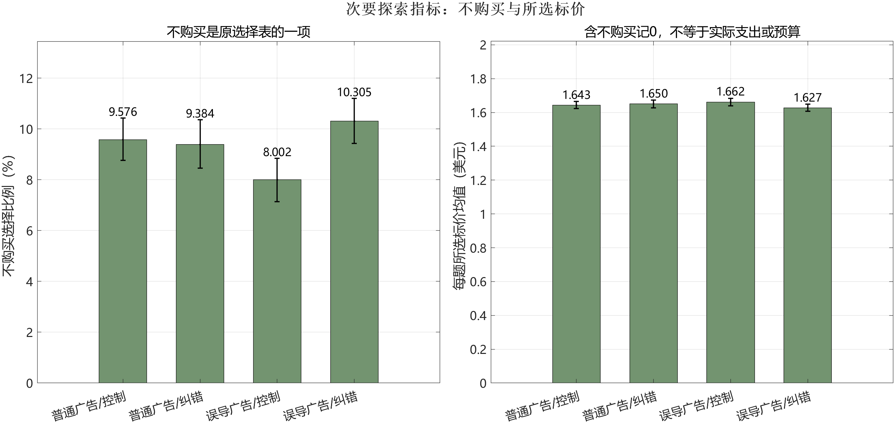

### 3.5 真实二手数据对证据判断的约束

事实信息、风险信念、商品选择与预算认可应分别记录。二手复分析先报告原始四臂，见表3；图2将主终点和后测信念并列，误差条为参与者整簇重抽样的逐项95%区间。

表3 原实验四臂的真实记录与描述性结果

{{ARM_TABLE}}

注：价格为每道选择题所选标价，不购买记0；美元值来自牙膏实验，不换算成充电器预算。含氟比例与不购买比例均先在每名参与者十题内计算，再按人等权平均。[Fong][DATA]

图2 四个真实处理臂的原观测均值及重抽样区间。两幅图的纵轴范围不同，不能按柱高比较两种结果的效果大小。

{{PRIMARY_RESULTS}}

这一比较显示，在公开清洗样本与原消息条件下，纠错后的风险信念和选择均值得独立观察。它不证明含氟选择增加就构成自主性提升；消费者也可能因口味、品牌、价格和其他安排选择不含氟商品。原论文已用选择模型研究信念和偏好及支付意愿，本文的描述性复算和重抽样不作为新的纠错效应发现，也不声称复现了其全部需求及均衡模型。

{{PRICE_RESULTS}}

图3 次要探索性指标。每项误差条为逐项95%参与者整簇重抽样区间，多个指标未作同时覆盖校正。

{{JOINT_RESULTS}}

回到充电器规范案例，不能用平均选择价格较低推断消费者已修改预算，也不能用更正后的信念分档取代有效表达。验收应分别检查：原理由的状态是否说明，公开的理由—预算联系是否处理，用户保留、修改或结束的表达是否被承接。哪项措施能提高真实理解、降低重审成本或改善净效果，需要直接包含这些变量的后续数据。

这也限制新增贡献的表述。二手数据复分析补强研究过程和测量边界，责任对象、完成条件及停止规则构成本文提出的规范细化。与依赖跟踪和选择性再确认功能相同的实现，可以满足同一判准；本次没有获得在这些实现之间比较处理效果的数据，不作优胜排名。

### 结论

AI导购的重要理由撤回后，纠错应照顾消费者已经公开用于预算修订的相关使用。是否需要主动补充，取决于理由重要性、公开联系、可调整性、现有更正的完成情况与相称负担。普通更正已经使关联可理解并保留修改机会时即可承接选择；独立理由充分、知情重申及退出限制重复重审。

这项责任以改善决定条件为目的，预算更新仍须符合消费者的有效表达和授权。必要纠错不自动恢复已拒绝的商业推动，既有选择性再确认也可以实现相同要求。本文以角色责任与程序性自主的规范分析辩护责任规则，并以二手实验中信念、选择、标价和不购买的测量区分约束验收。AI预算重审的实际理解、负担及效果留待匹配任务研究。
