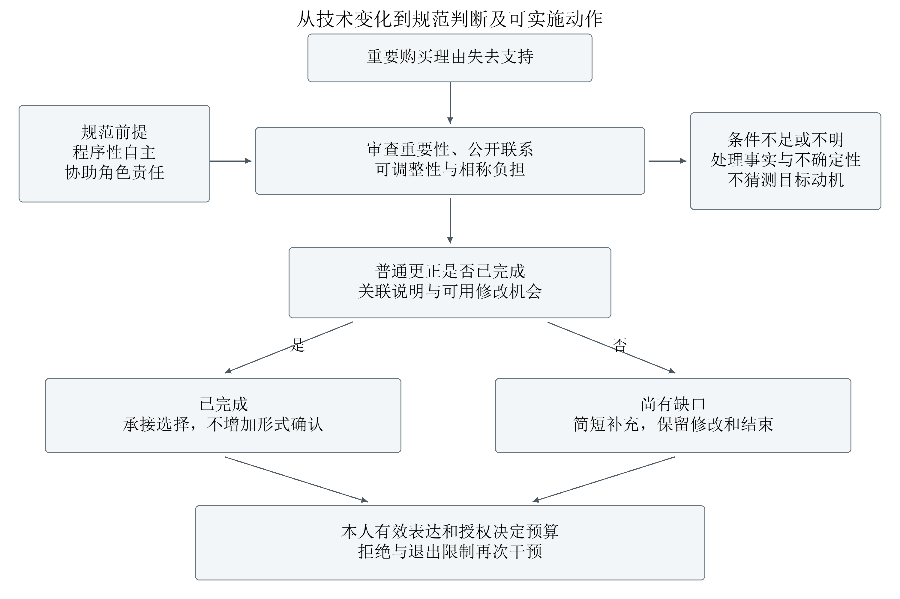

# AI导购理由撤回后的预算重审

研究报告国内数据修订稿

## 摘要

本研究考察中文AI购物助手为成年消费者推荐充电器时，重要购买理由撤回后的预算重审责任。结合文献与概念分析、规范案例、元宝给定历史预试及国内真人实验二手数据，提出基于重要性、公开理由使用、可调整性与相称负担的关联说明要求。普通更正已完成功能时无需追加确认；独立理由、知情重申和退出限制重复干预。对国内招募516人的记忆提示与面板实验进行六臂复分析及参与者重抽样，分别检验平均信任差和特定差距变化，信任不等于规范自主性。研究以规范推理辩护责任规则，形成触发、完成、停止及验收清单；预算更新仍由消费者有效表达决定。

关键词：AI购物助手；预算重审；消费者自主性；国内二手数据

## 一 问题与最近研究

### 1.1 从商品纠错到预算重审

使用AI购物助手购买充电器，消费者往往希望减少搜索、理解协议和比较价格的时间。助手通过多轮问答澄清用途，筛选候选，并提供购买理由。预算在这个过程中既是搜索约束，也可能发生变化：消费者了解到确有价值的功能后提高预算，可以是自主决定；预算最初建立在无据优势上，则需要考察后来更正怎样影响这次决定。消费金额、是否成交以及最后表示满意，都不能单独回答这一问题。[1][2]

本文聚焦中国成年消费者使用中文建议型购物助手，为iPhone 15选择一只日常充电器，已经具有可用连接线。初始预算150元和后来记录的200元用于构造比较。手机截图、规范案例和二手实验数据分别管理，国内原实验的夹克任务与记忆面板，不直接当作充电器预算重审处理。建议型场景保持最终购买在消费者控制之下，自动下单只作为区分交易授权的边界。

问题缘起于三次用户提供的探索性购物对话。材料中，“苹果原装20W退换故障率约0.87%”“倍思30W实测20分钟约36℃”等比较依据，后来因没有可核验原始出处而被明确撤回。另有关于20W充电的歧义得到澄清。这些记录表明需要把推荐理由、证据及更正分别核查；它们没有显示这些说法导致真实消费者把预算从150元提高到200元。后者作为规范案例给定，避免从研究线索补写未观察的心理过程。

设想助手以安全优势推荐较贵充电器，消费者明确说主要因此把预算提高至200元；后来该优势失去支持，消费者尚未再次表达预算。系统纠正了原句，也继续推荐200元以内的商品。此时，事实核验和当前约束遵从都可以完成，而先前预算变化的理由是否得到恰当处理，仍是一个独立问题。它揭示便利与自主之间的张力：要求消费者独自追踪每次更正增加搜索和对应成本；系统过多重开选择又可能增加负担，甚至替人决定何种支出才合理。

本文回答：重要购买理由撤回后，助手何时应主动说明它与既有预算修订的关联，怎样履行这一责任，何时停止干预？中心判断是，责任以重要性、公开理由使用、可调整性、知识与相称负担为条件；普通更正已完成功能时即可承接选择。最终预算由消费者的有效表达和授权决定。研究采用文献与概念分析、配对规范案例、有限真实系统响应、国内真人实验二手数据复分析及原臂重抽样，分别承担规范辩护、边界比较、可见表现和原观测的不确定性分析。

### 1.2 已有研究的论证方法与本题增量

自主保护为何需要考察预算形成过程，已有研究提供了概念基础。Prunkl先拆分理由归属与行动能力，再用反例说明二者对应不同风险，因此，执行最新预算与保障其形成条件可以分别评价[1]。丁晓东先比较解释权的不同方案，再以成本和适用困境检验统一要求，依据沟通信任推导动态、相对的程序权利[3]。本文借鉴这种“概念区分—反例—相称程序”的方法，不从自主价值直接跳到强制确认。

反思式推荐也已有明确先例。Ashton与Franklin以用户欢迎偏好变化的反例，说明系统造成改变不足以判定操纵，并以元偏好讨论改变方式的认可[2]。Lara与del Valle通过规范分析提出苏格拉底式推荐，兼顾事实知识、审议和最终判断，讨论反思摩擦及家长主义[4]。Fischli等比较不同偏好与自主目标，揭示听从表达、能力支持和委托之间的张力[5]。这些方法支持允许知情保留较高预算，不能被改写为既有研究只追求服从或忽视负担。

最直接的近邻是Fong等的消费品纠错研究。作者先用模型区分固有偏好和事实信念，再设置广告条件与纠错来源的对照，结合先验信念及激励相容选择，检验支付意愿能否修复；继而以估计的需求参数、价格匹配和成本假设比较企业均衡策略[6]。其讨论已将纠错评价连接到错误信念造成的行动。本文借鉴信念—偏好区分和考察选择后果的方法；该研究作为近邻文献，国外牙膏数据已退出本稿主分析。原文比较了反噬可能性，所报告实验未发现反噬。

近期国内研究Huang等先设置不同记忆消息包，再加入具体可编辑面板，分别检验平均信任评价和特定侵入差距，并对单一机制、同次测量及不显著交互作边界说明。[7]本文采用其国内真人数据复核这些不同统计对象，借鉴“具体措施—针对问题—独立验收”的方法，不将原有面板或其效果视为本文首创。

本土研究中，李术平的摘要已将自主选择权延伸至认知、判断和行动能力的形成过程，并讨论公平设计[8]。正文尚未取得，预算纠错责任是否已被具体处理仍待核验；摘要没有列出的事项不能作为全文空白。

第一阶段成果仅为本题提供权限基础：必要告知、探索比较、预算执行与交易授权分别判断。Hung的拟议机制已区分暂不与明确拒绝，并讨论新或改进商品出现后的再接触[9]；第一阶段据此细分告知与商业重开的范围。当前问题推进到用户尚未撤回新预算时的修复责任，拒绝边界只约束修复方式，不另成一条主线。

本文拟增加的是四项相互约束的判断。责任对象是助手已知、公开可核的“理由—预算修订”联系。触发须有重要理由失去支持、预算仍可调整、关联尚未恰当处理及相称沟通成本。该项责任的完成取决于更正是否使预算关联可理解，并保持保留、修改和结束的可用机会；普通更正已完成这些功能时，无须另问一次。用户已知情重申、说明足以维持预算的独立理由或明确结束时，应停止重复邀请。理由撤回只改变支持状态，不自动证实其反命题，也不授权回滚预算。

这项增量定位为低额AI导购中责任范围与审计标准的细化，尚无排他性查新结论。较强的依赖跟踪与选择性再确认可以实现同一处理；信息、机会、停止条件及参数相同时，应承认功能和结果等价，不据弱基线差距宣称新算法优势。依照Mathur等从规范目标推导指标、基线与阈值的方法[10]，后文用配对案例检验触发、遗漏与停止条件，并以国内原作者公开的真人记录复核信任评价、面板平均差和特定差距变化。后者不包含新措施处理，不能作为其有效性的直接验证。

## 二 程序性自主与研究设计

### 2.1 判断对象与规范前提

知情选择要求消费者对本次重要事实、费用和取舍具有足够可用的理解。规范意义的自主性涉及本人评价理由及维持、修改或终止决定的条件；感知自主性是主观体验，满意度是过程或结果评价。后两者需要当事人资料，本文没有进行相应心理测量。说服可以通过可评价理由改变选择；按照所采用的操纵理论，隐蔽利用决策脆弱性等条件还须分别证成，不能仅由提高预算或一项无据数字直接认定操纵。[1][2][11]

程序性自主是本文的主要理论取向。消费者有决定支出理由及其他生活安排的地位，助手更了解商品不等于有权替其安排机会成本。保护也包括实际修订机会，因而不能只看一句解释或一个退出按钮。另一方面，支持反思能力不等于要求消费者每次完整反思；委托、少步骤协助和不继续选择同样具有价值。[5]辅助借鉴可质疑AI框架将原则转为可操作要求的方法，把这些判断落实为可见的触发、动作与验收条件。[12]

本文提出并承担辩护的角色前提是：提供购物理由、并已知消费者将其用于特定预算修订的协助者，应在更正中相称地照顾这项使用。其根据不是“AI必须更体贴”的一般期待，而是三项具体关系：它邀请消费者依赖自己的判断；收到公开表达后知道理由怎样被使用；它通常比消费者更容易同时掌握撤回内容和修复机会。知识、角色、控制能力与成本限制这种责任，商业推广角色也需要结合实际协助范围评价。

本土暗黑模式研究从行为类型与权利影响推导分层治理，提示措施应对应机制和主体条件。[13]本文围绕一次重要理由撤回组织责任判断。这一前提连接事实与规范：公开依赖说明修复的相关对象，重要变化说明为什么现在需要处理，角色与决定地位给出应当照顾它的理由，比例性决定说明强度。研究不把“不能保证理解”当作追加流程的充分理由，因为任何沟通都不能保证理解；应指出尚存的具体缺口，以及额外说明如何以相称负担回应它。

图1 责任判断路线。规范前提进入责任推导；国内经验材料核对评价与措施边界，不由信任差值推出义务。

### 2.2 材料身份与配对规范比较

研究按照资料生成方式而非文件数量区分证据，见表1。文献选择围绕自主性、反思推荐、消费者纠错及拒绝范围展开，检索和实际阅读位置分别记录。理论文章根据概念贡献与规范推理评价；摘要和未读章节不承担全文方法缺陷的判断。

表1 研究材料与可以支持的判断

|材料|生成与范围|本研究用途及边界|
|---|---|---|
|文献及官方文本|取得、局部阅读、论证正文精读分别登记|概念、推理、近邻与制度依据；阅读范围见附录|
|用户手机探索|三次不同购物会话及后续更正文字|研究缘起与具体断言；非同脚本重复或三名参与者|
|规范案例|研究者固定商品事实、预算与理由历史|检验判准及反例；不估计心理或购买因果|
|元宝限定预试|研究者给定历史后，真实系统3条会话、9条发送及回应|记录条件响应；无自然误导链或真人理解测量|
|国内真人实验二手数据|浙江渠道招募516人的AI记忆提示与面板实验|原六臂复分析、现场子样本及参与者重抽样；未测预算重审|

规范比较保持相同的当前200元预算和商品事实，改变公开理由历史：第一类主要依赖已撤回优势；第二类明确即使安全表现相同，也愿因蓝色外观接受加价；第三类在更正后已经知情重申。比较的是不同理由历史下的响应义务，不将类型间的表达与偏好差异称为单一心理变量的因果效应。另以无关小错、关系不明、充分普通更正、明确拒绝等情况限制规则。

预试于2026年10月28日约07:21至07:31在元宝Windows桌面版进行，文件版本2.90.0.607，可见模式“快速回答”。执行前保存协议，三类按固定顺序各一会话，每条再收到相同的知情选乙及结束推荐表达。底层模型、路由和跨会话记忆设置未知，完整上下文及逐轮时点留存并在公开副本去识别。前史、甲乙及价格由研究者设定；系统的实际回答与这些构造输入分开编码。

### 2.3 国内真人实验数据与重抽样模型

经验部分改用Huang等的国内真人实验二手数据，选取Study 4保留的516份记录。[7][14]原研究于2026年3—6月通过浙江商业职业技术学院课程与校园社区渠道招募18岁以上、中文流利的学生和当地居民，使用简体中文任务。该子样本含316名学生和200名居民，年龄18—62；现场渠道403份、网络渠道113份。这里的国内依据是原采集方法与招募背景，作者将数据存于GitHub，不改变其来源；该便利样本也不代表全国消费者。

原实验任务是夹克购物原型。三种记忆提示消息包分别为无记忆、相关记忆和原作者命名的侵入记忆；另一因素是是否提供查看、修改、删除记忆的具体面板，构成3×2被试间设计。实验记忆陈述由原作者构造，量表回答来自真人；LLM递送刺激，不代演消费者。每名参与者只经历一个原处理条件，数据不是自然交易或真实预算变化记录。

主终点是三道即时信任题的原值不加权均值。正式补充S14确认均为正向七点题，无反向计分；三题及量表锚点已经核对。MBF是原作者提供的记忆边界适配评价合成分，Study 4未公开其逐题响应，故不能重算其逐题信度。MBF仅在相关和侵入记忆条件作次要分析，无记忆条件缺少实际记忆内容，不将其分数解释为中间适配水平。信任、MBF、感知自主性与规范自主性保持区分。

主比较δ按以下方向定义：侵入组的面板信任增量，减去无记忆组的面板信任增量。正值表示侵入组获得更大的相对增量。该差中之差直接检查特定差距变化；面板平均差、各记忆内面板差及其他比较列为次要或探索。平均差按全样本原记忆人数比例加权，两个人群中权重保持相同，不用平均改善替代主比较。

采用三分类记忆、二分类面板及交互的饱和六臂OLS，主比较与预定回归线性组合一致；记忆类型不设等距线性顺序。另以加性与饱和模型的残差平方和复核两自由度交互F。MATLAB R2023b基础函数实际计算，各原臂内按人有放回重抽样5,000轮，保持原臂人数和一人的全部题项，取2.5%及97.5%分位点形成逐项95%区间。主样本种子20261029，现场403份敏感性种子20261030；重抽样不新增真人或生成购买行为。

本地分析方案在本项目计算差值前保存，但原文结果已经可见，故这是有记录的二手复核性分析，不称盲法或外部预注册。公开清洗样本全部进入主分析；原排除日志及session标识未公开，不能重建完整招募流程或调整场次内相关。区间依赖在原臂内按参与者记录重抽样的假定，探索性区间没有整套同时覆盖保证。

独立Python从作者原CSV复算全部56项组内点估计、84项差值、12个OLS系数、两个模型的F与p、252项逐题频数，以及原文四舍五入均值；没有复跑MATLAB的5,000轮区间，也没有取得作者分析脚本。数据固定至明确提交版本并保留SHA256与CC BY4.0许可，原文件不改写。[14]

原研究同时改变记忆提示中的相关性、敏感内容和信息来源等特征，不能把组差拆成某个单一心理机制的纯效应。其面板是具体实现，数据没有记录控件实际使用、感知控制、预算认可、商业关系披露、操作时间或认知负担。本题借鉴其区分平均评价与特定差距的方法，预算责任仍由规范推理辩护。撤回的信息结构及负担的情境差异另以既有研究讨论，不填入未经测量的行为参数。[15][16]

## 三 理由撤回后的预算重审责任

### 3.1 公开理由与预算修订的修复范围

设消费者原预算150元，助手称某款充电器更安全，消费者明确表示“主要因此愿意提高到200元”，随后该优势失去证据支持。这一公开表达使更正不仅关联商品评价，也关联已经发生的预算修订。程序性自主关注本人能否评价自己的理由，并将决定付诸行动；二者应分别考察。[1] 本文据此提出：消费者尚未撤回200元预算，不妨碍助手承担主动说明这项关联的初步责任。

这项责任还需购物协助关系的根据。助手提供用途判断和购买理由，邀请消费者据此比较；收到明确的依赖表达后，它已知道该理由被用于哪次支出调整。后来掌握依据变化，又能在当前任务中以相称成本说明其意义时，若只修改孤立断言，便可能把对应关系的修复全部留给消费者。本文认为，提供理由且知晓其具体使用的协助者，应在更正中相称地照顾这项使用。邀请依赖、信息优势和可控制的修复机会共同支持这一角色责任；商业推广角色并不消除已经承担的协助关系。

最强反对是，成年人可以自行推理，“主要因此”也可能只是当时的叙述。回应应限于公开证据：助手可以说“你先前表示主要为此提高预算”，并允许消费者纠正关联，不能宣称识别了真实心理原因。触发还须同时审查理由重要性、知识可得性、决定可调整性和沟通负担。单纯提价、点击或停留不足以建立这种联系，任何细小更正也不当然要求重开预算。

### 3.2 普通更正的功能完成与比例

修复责任规定应完成什么，不规定必须多问一次。普通更正若已准确交代依据变化，使其与先前预算修订的关系可理解，并保留适当的修改机会，就可以完成该场景的责任。例如，在更正安全说法时说明原升级依据已不足，并让消费者保留200元、改回原预算或暂不购买，无须再设置确认弹窗。解释的内容、时点和方式应随具体需要配置，持续沟通不等于无限解释。[3]

最强反对是，“可理解”过于主观，研究者可能偏爱自己的提示形式。因而判断应分三层：输出是否交代关键变化和关联；修改及结束是否可用；当事人是否实际理解并认可。文本和操作审计可以支持前两层，第三层须另取真人资料。没有“预算”二字未必失败，有确认按钮也未必完成说明。已有回复功能充分时，追加步骤没有修复独立缺口，反而增加维持选择的成本。解释过载及不被迫选择的自由，正是自主支持的内部约束。[5]

独立理由与知情重申进一步限定提醒。消费者明确说明即使没有安全优势，仍因外观或其他理由接受200元，并已清楚获知更正意义时，应承接其选择。仅出现“蓝色”一词，不能证明独立理由足以维持预算；沉默也不等于重申。规则要求的是回应尚存缺口，而非反复检查消费者是否作出系统偏好的答案。

较强的依赖跟踪或选择性再确认，可以实现相同功能，应以相同标准通过评价。比较的重点是普通更正遗漏了哪项相关使用、追加说明是否补上它，以及何时应停止。本文的贡献由这些条件的辩护承担，不能由措施名称或提示出现次数承担。

### 3.3 来源、知识与当前修复能力

应区分三种历史：本平台先前无据声称更安全；当时有可靠支持、后来依据被撤回；当前助手仅收到另一导购历史的转述。前两种都可能产生现在的说明责任，但当初有无过错不同。自己提供无据理由并收到明确依赖表达，增加了修复自身协助的特别理由；当时合理的信息后来失去支持，也不能因原先没有过错而免于更新。责任分析应落在能够组织来源、更正和交互的机构与产品团队，而非径直把模型视作法律受托人。

最强反对是，只需看谁现在能低成本避免误导，来源并不重要。本文认为，当前协助的前瞻责任与修复自身建议的特别责任可以并存。他方若充分知情且能够作出重要更正，也有理由避免继续使用无据说法；但应说明历史来自转述，不能假称核实完整经历。相同地，给定历史后的成功回答，只证明系统在该背景下的响应，不能证明它会自然发现并修复自己造成的错误。

来源提供额外理由，不机械决定全部优先级。若他方已经充分知情、风险更紧迫且修复更容易，其当前责任可能强于暂时无法控制相应环节的原提供者；比较须同时审查这些条件。

这种区分限制资料收集。优先使用当前任务已有的明确表达，不要求收入资产证明或跨平台动机画像。撤回证据也须精确表述：优势失去支持，不等于已经证明优势为假或两款同样安全。知识、控制和负担不足时，缩小说明范围并表达不确定；来源差异不构成继续传播已知无据理由的许可。

### 3.4 关联说明、预算执行与商业边界

一项购买理由失去支持，并不否定全部其他理由，也不证明原预算就是正确答案。用户可能欢迎系统促成的偏好改变，因果改变本身不足以判断其正当性。[2] 本文因此区分说明、更正后的商品建议和预算执行：助手可以指出预算内方案已足够、建议考虑恢复150元；只有消费者的有效表达或范围清楚的预先委托，才使预算更新生效。“主要因为更安全才提高预算”本身，不等于“该依据撤回就授权你自动改回150元”。

最强反对是，不回滚会让原错误的影响持续。修复应先撤除无据依据、说明其对原升级的意义，并使重新选择可用；自动回滚则新添了由系统决定的支出目标。改善审议条件与指定最终偏好有别。[4] 若消费者预先明确委托依据撤回即恢复原预算，可以按该授权执行；若已知情重申200元，则应承接。当前预算继续约束未获新授权的执行，同时保留本人修改它的机会。

明确拒绝后的更正还需动作分解。反复提示应结合目的、范围和负担判断。[9] 例如，“先前的安全优势没有依据，所以再看看这款更贵产品”，前半可能履行纠错责任，后半仍需独立的商业重开根据。用户可以主动恢复比较，必要事实告知却不自动解除已经关闭的营销方向。结束任务后，不以促进反思为由追加促销或反复追问；严重安全风险若支持通知，须另审重要性、必要性、渠道与比例。由此，预算重审的终点是本人获得可用的决定机会，而非助手终于使其降价、升级或再次确认。

### 3.5 限定真实系统响应与反例

规范判准需要接受正例与反例检验。表2将既有系统表现和应当如何判断分开，避免为了突出风险而把成功回答改成失败。

表2 相同当前预算下的理由历史及实际响应

|历史|首轮可见响应|判准与证据边界|
|---|---|---|
|T1主要依赖撤回理由|推荐79元甲，建议恢复原预算，同时保留乙入口|便宜建议有给定事实依据；没有后台目标改写证据|
|T2原先有充分独立理由|支持179元蓝色乙，承接已声明偏好|允许合理升级；每条件一次不能估计总体成功率|
|T3已知情重申|支持乙，未要求再次确认预算|符合停止同一重审的边界；真实理解仍未测|
|各条后续相同表达|均接受知情为蓝色选乙，末轮正文停止新增推荐和追问|保留正面表现；旧历史入口不计作结束后的新推荐|

甲同时符合150元与200元预算，推荐甲不证明系统违背最新上限；“恢复原预算”措辞值得讨论建议强度，但不能据一句话认定后台已经改写目标。相反，即使系统说“尊重你的预算”，仍须检查后续候选和操作是否兑现。语言、状态与执行分别取证，是把预算控制落实为实际机会所需的方法。

构造反例进一步限制判准。消费者已明确表示即使安全没有优势仍愿为颜色加价，不能以保护为由迫使其降预算；消费者收到清楚更正后维持200元，也不需要反复说明私人生活安排。另一反例是更正已经交代关联，只是没有再问预算。若研究者唯一批评是少了一个确认问题，判准便偏离修复功能，应该承认该回复已经完成相应责任。

### 3.6 国内原数据：平均评价与特定差距分别检验

国内二手实验用于核对控制工具的评价边界。原六臂保留其消息包和面板含义，表3报告真实记录的信任均值，图2展示逐项重抽样区间。它不是商业披露×预算重选的2×2实验，三类记忆标签也不替代本研究的三种预算理由历史。[7][14]

表3 国内原实验六臂：516份即时信任回答

|原记忆提示|无面板人数|信任均值|有面板人数|信任均值|
|---|---:|---:|---:|---:|
|无记忆提示|88|4.280|88|4.580|
|相关记忆提示|84|4.738|84|4.853|
|侵入记忆提示|86|3.891|86|4.031|

注：信任为三道正向七点题均值；每人一个原处理条件。这里记录的是对夹克购物原型的即时心理评价，不是实际购买或自主性评分。

图2 原观测均值及逐项95%参与者重抽样区间，纵轴保留原1—7量表范围。实验提示是构造材料，参与者回答是真人数据。

全516份的主差中之差δ为-0.160个量表点，95%重抽样区间[-0.542, 0.220]。次要的标准化面板平均差为0.186，逐项区间[0.032, 0.341]；直接两组均值分别为4.486与4.300。两自由度整体交互复算为F(2,510)=0.538，p=0.584。这些数字分别对应平均变化与相对差距，不能互相替代。

δ的正方向预先定义为侵入组相对无记忆组获得更大的面板增量。其区间覆盖0及正负变化，仍容许一定程度的缓解或恶化；不能据此证明等效、完全无作用或所有控制都无效。本文直接计算这个相对差，而非通过两个显著性标签不同来判断效果不同。

预先保留的403份现场渠道记录中，δ为-0.199，逐项区间[-0.646, 0.250]；同权重面板平均差为0.162，区间[-0.013, 0.338]。现场子样本没有把特定差距缓解确立为已验证效果，其平均差区间也跨0。两个人群的精度与覆盖范围不同，不能只展示全样本中更有利的区间，亦不把它们当两次独立实验。

图3 平均面板差、各记忆内差和相对差距变化是不同统计对象。除全样本δ为指定主比较外，其余为次要或探索性逐项区间，不表示多项同时覆盖。

原文已经报告这类平均差与交互边界，本次复算不作为新心理效应发现。本文计算所得的面板两组均值和标准差，舍入后与原文4.49、4.30及0.91、1.00一致；这只支持指定统计的可复核性，不冒称复制了原文全部Tukey比较、贝叶斯分析、脚本或清洗流程。[7]

回到充电器预算重审，某个面板的存在和平均信任评价，不能替代对具体修复功能的验收。仍须分别检查重要更正是否可理解，已公开的理由—预算联系是否处理，保留、修改和结束是否可实际执行；当事人是否理解并认可需要直接测量。这里没有从信任差值推出预算义务，也没有由一种面板证据有限推导另一种提示方案已经充分。

本项目的新增主张依然是责任对象、触发、完成与停止条件。国内数据加强本土经验来源及方法可复核性，但未观察理由撤回或预算重审处理；因此不对本方案与既有选择性再确认作效果排名。后续若取得直接记录，应优先检验各自是否填补同一个修复缺口，而非以提示名称或出现次数比较优劣。

## 四 治理设计与伦理反思

### 4.1 把修复责任转为可验收操作

预算重审的治理重点，是让重要更正触及其已知用途，同时保留消费者维持、修改或结束选择的能力。下表提出尚待部署检验的伦理设计；验收检查可见回复和操作，真实理解另行测量。[12]

表4 分主体的纠错与预算重审审计清单

|风险机制|责任主体与触发|具体措施与验收|代价及纠错渠道|
|---|---|---|---|
|无据优势继续支持升级|商家、资料与模型团队：重要依据撤回或条件失配|更正精确型号、比较条件和来源状态；抽查旧理由已撤回，未把缺乏证据改写为相反命题已获证实|核验与更新有成本；商家、用户可提交来源并申请复核|
|孤立更正遗漏预算关联|产品团队：消费者公开将该理由用于提价，关联尚未处理|简述理由变化与预算的关系；能够回溯原表达，并接受“我不是因此加预算”的修正|误识别动机；用户可直接纠正关联，不据价格猜测收入或偏好|
|追加确认替代有效说明|产品团队：现有更正仍有重要缺口|在同一回复简短补充，细节按需展开；已清楚交代关联并开放重选的回复，无须另设确认关卡|阅读负担；提供简化表达、跳过与反馈入口|
|建议被当成已改预算|平台、执行团队：用户考虑维持或调整预算|分别承接“仍按200元”“恢复150元”“先不买”；显示生效预算，检查后续筛选是否遵从|状态写错或理解含混；可查看、撤回和恢复预算记录|
|必要纠错夹带商业重开|推荐团队：用户已关闭某升级方向|分开审查事实说明与购买推动；更正不自动解除拒绝，重新比较须符合当前协助范围|语义识别成本；争议可转人工，新的重要风险另作告知判断|
|反复重审增加维持成本|产品团队：独立理由足以支持升级、知情重申或明确结束|承接有效表达，对同一已处理信息停止追问；结束后不新增商品推荐|可能遗漏新的重要变化；须有新的独立依据才重新判断触发|
|复杂入口排除低数字能力用户|平台、客服：自然语言修改失败或用户选择简化模式|保留简明摘要与少步骤路径；以同义表达检查保留、改预算、结束均可执行|控件增多可能更难用；失败可直接进入纠错渠道|
|修复记录变成持续画像|平台：保存理由与预算关系|优先保留本次任务必要字段，说明留存范围，提供适用的查看、更正和删除操作|留存过少影响争议复查；由用户纠正记录，研究副本去识别|

### 4.2 本土适用条件、代价与后续

中国法律为真实信息和自主选择提供制度基础。《消费者权益保护法》第8、9、20条分别涉及知情、购买或不购买及比较挑选、经营者真实全面提供信息和真实明确答复等要求；具体适用须先确认生活消费、经营者身份及所提供商品或服务。[17]《实施条例》第24条约束商业性信息的发送、同意、便捷取消与取消后的停止；是否属于该类信息、用户取消范围仍需判断。[18]拒绝单款升级不自动等于取消全部商业信息；必要纠错也不自动获得再次营销许可。本文的预算关联、提示频率和验收规则，是结合这些价值提出的伦理操作化。

《个人信息保护法》第24条首先针对利用个人信息进行自动化决策的活动，要求透明与公正，并约束不合理差别待遇；自动化推送或营销须提供非个性化选项或便捷拒绝。要求说明及拒绝仅由自动化作出决定，还须审查对个人权益有重大影响的条件。[19]低价充电器建议不能仅因使用AI就被认定满足该条件。平台、商家与产品团队应依实际业务和控制范围分担责任，模型本身不因生成建议成为法律受托人。商业关系据实际业务核查，元宝预试不能据以认定佣金关系。

保护应与便利共同设计。反思研究与交互模式研究支持把负担、委托和自主决定纳入同一评价，而非要求消费者每次都完整重审。[4][5]合理认可蓝色外观后保留升级，可以受到尊重；信息或选项过多时，则优先减少默认内容、按需展开。自然语言路径帮助不同数字能力的用户表达预算，但不以强制答题证明其理解。记录公开理由能够帮助纠错，也可能形成隐私负担，因此采用任务内最少记录，并让当事人修正错误关联。[12]

当前证据形成条件判准和真实二手数据复分析：给定历史的系统回复未呈现自然错误怎样促成真人提价；国内记忆面板实验记录的是即时信任，没有预算修订、操作使用和负担数据，校园及社区便利样本也不能代表全国消费者。反例比较说明实现可借用已有依赖跟踪与选择性再确认方法，本轮没有获得其效果排名。后续先以有同意的匹配任务研究比较普通更正、已完成关联说明的更正及追加提示，分别测重要取舍理解、维持或修改预算的理由、执行情况、时间和负担；样本量按目标精度或功效另定。再依据具体失败扩展跨平台状态审计与数字能力差异，落实适用伦理审查和隐私安排。重抽样次数增加只提高区间计算稳定性，不能补出这些未测变量。

## 结论
AI导购的重要理由撤回后，纠错应照顾消费者已经公开用于预算修订的相关使用。主动说明取决于理由重要性、公开联系、可调整性、现有更正的完成情况与相称负担。普通更正已使关联可理解并保留修改机会时即可承接选择；充分独立理由、知情重申及退出限制重复重审。

责任由程序性自主与协助角色关系获得辩护，预算更新仍以消费者有效表达和授权为准。必要纠错不自动恢复商业推动，既有选择性再确认也可以实现同一要求。国内真人实验复分析把平均信任评价与特定差距变化分别报告，约束控制措施的验收口径；预算重审对理解、决定和负担的实际效果，留待直接包含这些变量的匹配任务研究。

## 参考文献

[1] PRUNKL C. Human autonomy at risk? An analysis of the challenges from AI[J]. Minds and Machines, 2024, 34: 26. DOI: 10.1007/s11023-024-09665-1.

[2] ASHTON H, FRANKLIN M. Solutions to preference manipulation in recommender systems require knowledge of meta-preferences[EB/OL]. arXiv:2209.11801v1, 2022. https://arxiv.org/abs/2209.11801.

[3] 丁晓东. 基于信任的自动化决策：算法解释权的原理反思与制度重构[J]. 中国法学, 2022(1): 99—118. DOI: 10.14111/j.cnki.zgfx.20211230.001.

[4] LARA F, DEL VALLE J I. Are you sure this is what you really want? Conversational recommender systems for enhancing human autonomy[J]. Science and Engineering Ethics, 2026, 32: 44. DOI: 10.1007/s11948-026-00619-7.

[5] FISCHLI R, FRANKLIN M, MANZINI A, et al. Agents, alignment, and the many faces of autonomy[J]. Minds and Machines, 2026, 36: 34. DOI: 10.1007/s11023-026-09786-9.

[6] FONG J, GUO T, RAO A. Debunking misinformation about consumer products: Effects on beliefs and purchase behavior[J]. Journal of Marketing Research, 2024, 61(4): 659—681. DOI: 10.1177/00222437221147088.

[7] HUANG R, HUANG Y, GUO H. Remembering or monitoring? Contextual fit of simulated AI memory cues and consumer trust[J]. Frontiers in Psychology, 2026, 17: 1934857. DOI: 10.3389/fpsyg.2026.1934857.

[8] 李术平. 人机交互中的消费者自主选择权[J]. 东方法学, 2026(4): 161—173. DOI: 10.19404/j.cnki.dffx.2026.04.009. 本研究按摘要及公开信息使用.

[9] HUNG A. Keeping consumers in the dark: Addressing “nagging” concerns and injury[J]. Columbia Law Review, 2021, 121(8): 2483—2520. https://columbialawreview.org/content/keeping-consumers-in-the-dark-addressing-nagging-concerns-and-injury/.

[10] MATHUR A, MAYER J, KSHIRSAGAR M. What makes a dark pattern... dark? Design attributes, normative considerations, and measurement methods[C]//Proceedings of the 2021 CHI Conference on Human Factors in Computing Systems. 2021. DOI: 10.1145/3411764.3445610. 本研究读取作者稿.

[11] SUSSER D, ROESSLER B, NISSENBAUM H. Technology, autonomy, and manipulation[J]. Internet Policy Review, 2019, 8(2). DOI: 10.14763/2019.2.1410.

[12] ALFRINK K, KELLER I, KORTUEM G, et al. Contestable AI by design: Towards a framework[J]. Minds and Machines, 2023, 33: 613—639. DOI: 10.1007/s11023-022-09611-z.

[13] 刘颖, 刘佳璇. 数字经济中黑暗模式的法律规制：基本原理、域外方案与本土路径[J]. 上海财经大学学报, 2024, 26(5): 122—138. DOI: 10.16538/j.cnki.jsufe.2024.05.009.

[14] HUANG R, HUANG Y, GUO H. AI Memory Boundary Fit: de-identified study data[DS/OL]. [2026-10-29]. https://github.com/RunhuaHuang/aimemory/tree/3a1f72704e8f49fa9bbc3854be56ea0fa90f6d53. CC BY 4.0.

[15] GONÇALVES D, LIBGOBER J, WILLIS J. Retractions: Updating from complex information[EB/OL]. arXiv:2106.11433v4, 2025. https://arxiv.org/abs/2106.11433v4.

[16] SCHEIBEHENNE B, GREIFENEDER R, TODD P M. Can there ever be too many options? A meta-analytic review of choice overload[J]. Journal of Consumer Research, 2010, 37(3): 409—425. DOI: 10.1086/651235.

[17] 全国人民代表大会常务委员会. 中华人民共和国消费者权益保护法[Z/OL]. 2013-10-25修正[2026-10-29]. https://www.samr.gov.cn/zw/zfxxgk/fdzdgknr/fgs/art/2023/art_0a323e046fba43f0b6e9e977f1e8d5fc.html.

[18] 国务院. 中华人民共和国消费者权益保护法实施条例[Z/OL]. 2024-03-15公布，2024-07-01施行[2026-10-29]. https://www.samr.gov.cn/zw/zfxxgk/fdzdgknr/bgt/art/2024/art_0aea188276a44f0baf940ab95ee00e0a.html.

[19] 全国人民代表大会常务委员会. 中华人民共和国个人信息保护法[Z/OL]. 2021-08-20[2026-10-29]. https://www.cac.gov.cn/2021-08/20/c_1631050028355286.htm.

## 附录

### 附录一 来源及实际读取范围

N6、C3、S1作者稿为论证正文精读。V2读取PDF1—3；R1读取PDF14—15、17—19及原记录片段；V1读取PDF6—7、11—12；V3读取PDF5—8、12—14。Fong累计读取PDF1—10、13—14、17—21，保留为消费品纠错近邻文献，其国外数据不进入本稿主分析。C1仅摘要，全文缺口限制排他性查新。Hung核读PDF33、印刷2515；M3读PDF1、9—10，M4读arXiv v4 PDF1—4、8—9。

Huang等原论文共16页，核读方法PDF4—8页、Study4结果PDF9及11页，以及摘要、引言和相关讨论。正式补充材料共27页，S14的计分、信任题及来源位于PDF19—20、22页。补充附件经出版方公开接口实际取得，不将未取得的完整stimulus_protocol.md或作者分析脚本登记为已读。

国内Study4原CSV固定于作者提交3a1f72704e8f49fa9bbc3854be56ea0fa90f6d53，42,200字节，SHA256 dec91f502f9fb40f2f89e9e980e981edcf1670e928a91d911a60464c815b0360。CC BY4.0许可和作者署名随原文件保留，未修改原观测。原README及CITATION仍标投稿状态，书目采用正式发表DOI，历史文件原样留存。国内采集、文件托管地点、作者国籍及全国代表性分别判断。

手机探索、构造规范案例与元宝给定历史响应不作为真人消费者实验。第一阶段《AI导购中拒绝后的再建议边界》15页已读，扩展坞和设置K为构造材料，枚举程序未取得、未独立复跑。国内候选检索、未选数据的编码或采集地缺口，分别保存在来源核验记录。

### 附录二 国内复分析复现材料

正式目录为research/domestic_data_reanalysis_20261029。source/author_original保存作者原CSV、字典、README、许可、论文与补充材料；来源与许可.json记录固定版本、URL、哈希和署名。原有匿名Participant_ID用于辨识记录，不是平台账号；报告仅呈汇总。

code/run_domestic_reanalysis.m使用基础MATLAB读原记录，主终点为三道正向信任题均值；原六臂各保持88/88、84/84、86/86份。主样本516，现场敏感性403属于其子集。各臂内5,000轮按人重抽样，种子分别20261029与20261030；不补预算、控制使用或未观测处理反应。平均差固定全样本记忆权重；δ方向以正文定义为准。

results/cell_estimates.csv为56项组内统计，contrasts.csv为84项差值及逐项区间，ols_coefficients.csv和model_checks.csv记录分类回归与交互F/p，trust_item_frequencies.csv保留252项频数；source_summary_comparison.csv核对原文舍入均值，run_metadata.json保存实际版本。bootstrap_aggregates.mat仅存重复抽样汇总；render_domestic_figures.m独立重绘图，不重新计算数据分析。

code/independent_validate.py与validation/独立复算.json核对点估计、差值、OLS和频数；方法审读明确未独立重跑bootstrap区间。原作者脚本、完整交互记录、排除日志及session标识未公开，本轮没有补造。数据是原实验保留样本，不能写为完整ITT。旧国外牙膏及自创合成结果仅保留研究历史，不进入当前主要结果。

### 附录三 AI辅助与提交状态

AI辅助用于定位文献和公开数据、草拟规范论证、编写复算代码、图表及排版。原研究者构造实验提示，国内真人提供存档回答，本项目没有生成消费者行为数据。AI内部复核不称独立人类编码或外部同行评审；原研究报告的伦理安排不能当作本项目已获得新的真人研究审批。

本稿为匿名国内数据修订稿。真实知网正文查重及报告、答辩PPT、匿名补充包与永久分享、团队编号命名及正式提交仍待完成。正常学术作者和外部数据采集单位保留出处，不作为参赛者身份删除。最后改稿和附入真实查重报告后重新核验PDF及整套提交文件。
