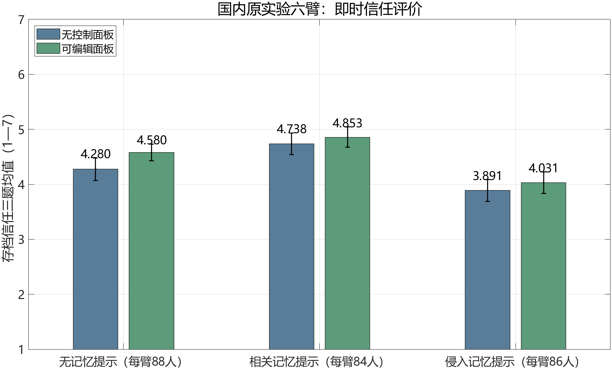
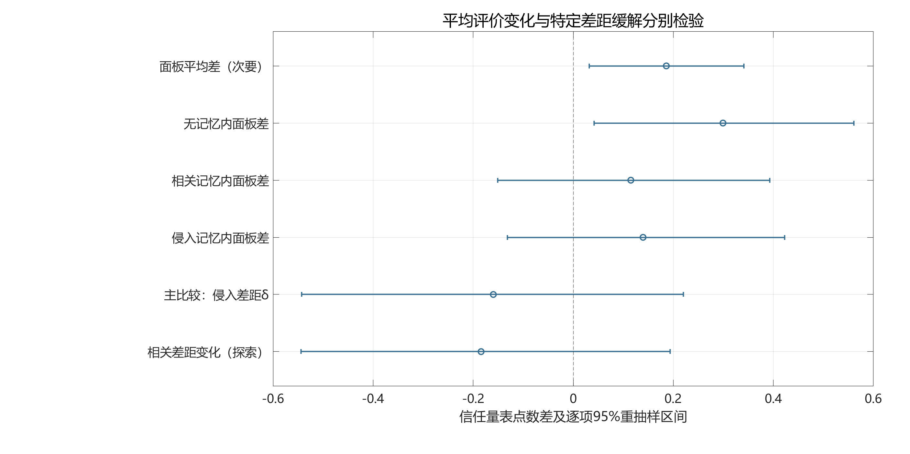

### 3.6 国内原数据：平均评价与特定差距分别检验

国内二手实验用于核对控制工具的评价边界。原六臂保留其消息包和面板含义，表3报告真实记录的信任均值，图2展示逐项重抽样区间。它不是商业披露×预算重选的2×2实验，三类记忆标签也不替代本研究的三种预算理由历史。[Huang][DOMDATA]

表3 国内原实验六臂：516份即时信任回答

{{CELL_TABLE}}

注：信任为三道正向七点题均值；每人一个原处理条件。这里记录的是对夹克购物原型的即时心理评价，不是实际购买或自主性评分。

图2 原观测均值及逐项95%参与者重抽样区间，纵轴保留原1—7量表范围。实验提示是构造材料，参与者回答是真人数据。

{{MAIN_RESULTS}}

δ的正方向预先定义为侵入组相对无记忆组获得更大的面板增量。其区间覆盖0及正负变化，仍容许一定程度的缓解或恶化；不能据此证明等效、完全无作用或所有控制都无效。本文直接计算这个相对差，而非通过两个显著性标签不同来判断效果不同。

{{SENSITIVITY_RESULTS}}

图3 平均面板差、各记忆内差和相对差距变化是不同统计对象。除全样本δ为指定主比较外，其余为次要或探索性逐项区间，不表示多项同时覆盖。

原文已经报告这类平均差与交互边界，本次复算不作为新心理效应发现。本文计算所得的面板两组均值和标准差，舍入后与原文4.49、4.30及0.91、1.00一致；这只支持指定统计的可复核性，不冒称复制了原文全部Tukey比较、贝叶斯分析、脚本或清洗流程。[Huang]

回到充电器预算重审，某个面板的存在和平均信任评价，不能替代对具体修复功能的验收。仍须分别检查重要更正是否可理解，已公开的理由—预算联系是否处理，保留、修改和结束是否可实际执行；当事人是否理解并认可需要直接测量。这里没有从信任差值推出预算义务，也没有由一种面板证据有限推导另一种提示方案已经充分。

本项目的新增主张依然是责任对象、触发、完成与停止条件。国内数据加强本土经验来源及方法可复核性，但未观察理由撤回或预算重审处理；因此不对本方案与既有选择性再确认作效果排名。后续若取得直接记录，应优先检验各自是否填补同一个修复缺口，而非以提示名称或出现次数比较优劣。

### 结论

AI导购的重要理由撤回后，纠错应照顾消费者已经公开用于预算修订的相关使用。主动说明取决于理由重要性、公开联系、可调整性、现有更正的完成情况与相称负担。普通更正已使关联可理解并保留修改机会时即可承接选择；充分独立理由、知情重申及退出限制重复重审。

责任由程序性自主与协助角色关系获得辩护，预算更新仍以消费者有效表达和授权为准。必要纠错不自动恢复商业推动，既有选择性再确认也可以实现同一要求。国内真人实验复分析把平均信任评价与特定差距变化分别报告，约束控制措施的验收口径；预算重审对理解、决定和负担的实际效果，留待直接包含这些变量的匹配任务研究。
