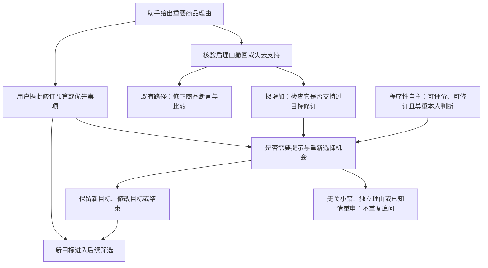

# 继续寻找创新点：三条候选与推荐

后续状态更新：用户重新授权操作已安装的元宝桌面版，已执行3条构造案例预试；[结果与论证修订](%E5%85%83%E5%AE%9D%E6%A1%8C%E9%9D%A2%E7%89%88%E9%A2%84%E8%AF%95_%E7%BB%93%E6%9E%9C%E4%B8%8E%E8%AE%BA%E8%AF%81%E4%BF%AE%E8%AE%A2.md)强调“评价性建议”不等于“替用户改写目标”，并保留独立理由、知情重申及结束响应的成功表现。本稿以下为预试前的候选推导，原文保留，不追认构造历史为系统自行产生的错误。

日期：2026-10-28（Asia/Shanghai）。用户已要求跳过当前浏览器验证；本轮仅作有记录的文献续查、规范论证与构造案例设计，没有向元宝发送测试消息。沿用academic-research-suite与anti-defensive-writing。以下均为供作者审阅的候选贡献，不宣称首创。

## 先给明确建议

建议优先研究：**AI纠正错误购买理由后，是否还应重新开放用户据此作出的目标选择？**

例如在研究者构造的案例中，用户原预算150元，因AI声称升级款“更安全”而同意提高到200元；随后AI撤回安全优势。此时，只改商品说明、直接恢复150元、继续把200元当无须说明的既定偏好，可能是三种不同处理。需要论证第四种：说明撤回对原升级理由的影响，让用户有低成本机会保留、修改或放弃新目标，同时尊重其不继续比较的决定。

这一问题比“AI要准确、要改错”多追问了一层：**错误不只可能进入推荐理由，也可能参与形成后来被系统当作用户要求的目标。**目标来源的历史能否改变纠错责任，是本轮拟争辩的具体判断。

150→200及“更安全”的关联均为CASE设定，原三次实录没有观察到这种预算上调链。实录的作用是提供“预算执行和指定纠错均有成功表现”的背景及研究线索，不能承担新命题的发生率或用户效果结论。

## 1. 先排除哪些过宽的创新表述

|容易被当成创新的说法|已核近邻|本轮处理|
|---|---|---|
|AI应提供真实、可核验的购买理由|R6—R9已有事实性、原子陈述、解释修正及引文支持方法|作为必要方法基础，不作首创|
|有回复按钮不等于能有效质疑，不能把所有举证成本交给消费者|N7及V1已有信息、学习支持、实际改决定能力与负担转移讨论|继续采用，不能只换购物场景就声称新理论|
|用户偏好会改变，应关注对偏好改变的认可|V2明确提出偏好改变偏好与相关同意；R1提出元偏好反思|不能把“首次关注目标改变”作为增量|
|听从用户的表面要求不总等于保护自主|N6与V3已区分自主条件、陈述/知情等偏好|本题必须给出具体冲突案例与判定边界|
|重新确认是一种新设计|V5微软HAX已有提醒过去选择并重新确认的设计模式|不把多一个确认按钮当创新；须比较触发条件和不干预边界|
|对话/行为反馈不能自动变成稳定偏好|V4已有预测与持久画像写入的分离|不把“不要立即写入用户画像”泛称首创，也不推定元宝实际写了长期画像|

这些近邻强化了筛选标准：新增框架名称、换充电器场景、加入MATLAB或设计2×2，本身均不足以形成贡献。

## 2. 三条候选路径

### 路径①：纠错是否应触及由错误依据促成的目标变更（优先）

1. **最近研究及已有步骤**：V2提出尊重用户想怎样改变偏好；R1支持围绕元偏好及经验知识进行反思；V3展示听从陈述偏好与支持知情偏好间的张力；V5已有重新确认模式。原方案的时序判准还关注授权范围与撤回。
2. **拟增加的一步**：把“商品事实撤回”追溯到它公开支持的那次目标修订，区分两种同为最新200元目标的情形：用户明确因已撤回的可靠性理由而改变，与用户基于独立、仍成立的外观偏好而改变。由此论证何时需要重新开放选择，何时继续执行即可。
3. **推进解释**：可以解释为什么同样听从最新预算、同样撤回错误、同样推荐某款，仍可能在目标形成条件上需要不同处理；评价单位是“理由—认可—目标—后续执行”的公开关系。
4. **需要证据**：文献中的自主/偏好分歧；明确记录依赖理由的构造或真实对话；事实撤回记录；独立理由与用户后续表达。当前可完成规范案例比较，真实效果留待增强。
5. **推翻或限制它的反例**：目标改变基于独立理由；用户已知情重申；被撤回事实无关紧要；再次提问妨碍退出；系统无法知道用户依赖理由。上述情形限制触发，而非一律再确认。
6. **评分、成本和完成条件**：关联创新价值、理论框架、学术过程、实用价值和反思。文献与成对CASE的完成成本中等，无须继续浏览器取证；若欲声称减少误购或提高自主感，必须另有真人资料。相对V2/R1/V3/V5若没有判断增量，应降为本土规范操作化。

### 路径②：一般质疑与带有专业证据的质疑，是否得到不同纠错支持

1. **最近研究及已有步骤**：C3的持续沟通、N7的透明性负担、V1的申诉可用性与信息支持，已说明有效质疑需要条件。
2. **拟增加的一步**：对同一断言固定上下文，分别使用“这个说法有可靠依据吗”“请提供型号和测试条件”“该测评属于另一型号，证据如下”三级提示，记录纠错对用户事先掌握答案的依赖；区分用户知道得更多与提示直接注入答案。
3. **推进解释**：现有三条针对性质疑后的成功，不能单独说明普通消费者仅表达疑惑时也能得到同等支持。将“愿意纠错”与“是否要求用户先完成调查”分开。
4. **需要证据**：同一冻结输入、真实出处、预定提示和完整输出；不清楚用户技能时只评价提示条件，不能把AI代演叫真人低技能组。
5. **反例/限制**：一般质疑也能完成核验；具体证据合理地帮助复杂任务；不同结果来自答案内容而非数字能力。需要答案注入和字数/信息量控制，不能只凭专家提示更有效就判不公。
6. **评分、成本和完成条件**：方法过程和需求/实用关联强，理论原创空间较窄。当前用户跳过验证，此路径只保留设计，不生成差异结果或成功率。以后恢复审计再执行，真人差异另需研究。

### 路径③：消费者选择少解释，是否同时减轻平台的事实核验责任

1. **最近研究及已有步骤**：N2区分能力和行使；I5/R1讨论负担；V3的元自主允许不同委托模式；N7/V1反对把监督成本全部转给个人。
2. **拟增加的一步**：在同一事实质量下区分“用户选择不展开说明”与“系统未经核实却给出确定比较”；讨论用户要求“直接推荐”能否被当作降低关键依据核验标准的理由。
3. **推进解释**：有些用户愿意节省阅读时间，这与认可未经支持的安全/兼容优势不同。低展示量也可能支持自主，更多引用也可能只是把工作转移出去。
4. **需要证据**：理论概念比较；核验是否完成与展示多少的构造对照；若研究负担收益需记录实际理解、时间及退出。
5. **反例/限制**：低价任务全面核验费用过高；消费者明确接受不确定性；资料无法取得。结论应是按重要程度配置核验与不确定性表达，而不是要求无误或强迫披露全部内容。
6. **评分、成本和完成条件**：理论、治理和反思关联较强，构造论证成本较低；与现有透明性谬误及委托文献重合较多，优先作为边界论证。

## 3. 为什么优先路径①

|比较依据|路径①|路径②|路径③|
|---|---|---|---|
|新增的具体判断对象|错误依据参与形成的目标修订及其后续地位|纠错对提示信息的依赖|核验与展示责任是否分离|
|与先前方法的区别是否清楚|较清楚：仅改事实/仅跟踪最新目标，可能遗漏目标的公开理由来源|可以清楚测量，但控制答案注入较难|概念上清楚，广泛原则已有先例|
|现有实录能支持什么|背景和线索；没有预算上调链|已知有针对性质疑，但没有匹配的一般质疑对照|可说明资料与后续追问，未测用户委托偏好|
|跳过浏览器后能完成什么|规范推理、明确触发与反例、CASE判读和治理建议|协议与指标，不能形成审计结果|概念论证和低负担原型|
|主要风险|把一般知情同意/再确认原则重新命名，或过度否定用户选择|把提供更多答案误说成对专家偏好|只是重述真实性义务与分层披露|

推荐①是因为增量最具体且可由规范研究承接，不是因为已证明首创或预测得分更高。②用于未来经验检验，③作为限制干预成本的边界。

## 4. 推荐路径的完整论证骨架

主理论仍为程序性自主，辅助仍限价值敏感设计。V2/R1/V3用于比较理论选项，不把它们变成必须同时接受的多套主理论。

**核心研究问题**：AI购物助手撤回了促成消费者目标修订的重要购买理由后，怎样处理该目标，才既支持知情选择，又尊重消费者自己的决定？

**可争辩的中心论点**：在目标修订对某项助手提供的实质事实理由存在可观察依赖、该理由失去支持、且决定仍可调整的条件下，适当纠错应说明其对原升级理由的影响，并提供低成本的重新选择机会。系统不应自行宣告用户的新目标无效，也不应把仅仅遵从最新目标当作全部自主条件已满足。对已知情重申、独立理由或轻微无关更正，不重复触发。

“重新选择机会”不等于所有建议必须再走一次强制审批。它可以是一次简短提示与可用操作；消费者可保留新目标、修改目标或结束。未回应不被研究者当作知情重申，也不据此替用户恢复初始目标。本文只研究建议型导购，交易授权另属其他范围。

### 子论点1：最新目标的执行与目标形成条件可分开

- 主张：同为“预算200元”，公开理由历史可能不同。
- 规范前提：程序性自主重视以相关信息形成、评价并修订理由的机会，而不以最初目标永远不变为标准。
- 事实证据：文献已有陈述/知情偏好、元偏好与改变认可的区分；本题预算变化链使用CASE，不称实录。
- 推理桥梁：若信息是用户自己表明的升级理由，撤回它可能影响其认可基础，仅存一个金额会遗漏该关系。
- 最强反对：根据动机推测无效，会越过消费者自我决定。
- 回应：只取可观察的理由关联，不推断隐秘真实偏好；目标本身不被宣告无效。
- 边界：依赖关系不清时保留不确定性，不能从“贵了”推出受到操纵。

### 子论点2：重要事实更正可触发针对目标的提醒与重选机会

- 主张：纠错范围有时需要从商品比较扩展到先前的目标变更。
- 规范前提：关键依据失去支持后，当事人应有据新信息调整决定的机会。
- 证据：C3动态程序、V2改变认可、R1经验知识与反思，以及V5再确认模式提供基础；CASE检验其具体适用。
- 推理桥梁：商品结果改变与用户目标更新是不同环节，纠正一项不保证另一项受到适当处理。
- 最强反对：这不过是现有再确认原则。
- 回应：把既有原则作为强基线，新增部分限于触发、依赖范围、无需再确认的反例及与持续执行的关系；如果强基线全部覆盖，收缩贡献。
- 边界：不是任意新信息都触发；仅对任务及修订理由有实质影响、尚可调整的决定。

### 子论点3：恢复原目标与维持新目标，都应由消费者决定

- 主张：纠错不能自动恢复150元，也不能强迫保留200元。
- 规范前提：用户可基于新理由认可升级，也可以选择省事、不继续比较。
- 证据：N2能力/行使、N6真实性和V3对家长主义的边界；CASE中设置撤回后明确重申的用户。
- 推理桥梁：更正信息应修复选择条件，而非由研究者把“最便宜”“最初预算”变成唯一正确结果。
- 最强反对：允许继续升级可能保留错误的影响。
- 回应：说明影响并提供真正可用的修改机会；有独立理由且知情重申时尊重决定。是否仍受心理影响需真人研究，不能靠强制降预算解决。
- 边界：没有后续表达时不报告偏好已经完成更新；拒绝继续对话时停止。

### 子论点4：程序强度应与重要性、证据控制力和负担相称

- 主张：默认简短提示，关键材料按需展开，避免每轮重新问遍预算和价值观。
- 规范前提：支持自主包括可用机会及有限注意，不要求持续穷尽反思。
- 证据：N7/V1已有负担转移讨论；R1/V3明确干预、摩擦、退出和过载张力。
- 推理桥梁：若修复流程比原问题更难用，形式上的再确认可能无法服务其规范目的。
- 最强反对：提醒太少遗漏重要风险；太多又妨碍便利。
- 回应：按理由作用及目标影响触发，保留单次中性提醒与可直接结束的方案，效果另测。
- 边界：没有时间/理解数据不声称更省时；适度措施也不是完整自主性的充分条件。

## 5. 借鉴方法与拟增加的一步

相对前面两版方案，变化具体如下：原“目标修订/撤回执行”检查用户已要求改变后系统是否照做；前一轮“纠错重评”检查撤回事实是否影响商品比较。本轮候选再追问：**用户尚未主动撤回新目标，而系统已经知道自己提供的关键依据失去支持时，是否应主动说明它与那次目标修订的关联？**新增的是这个责任触发与范围问题，不是再测一遍预算遵从。

该图描述公开理由关系与规范判断，不声称已识别因果心理影响、后台排序或持久记忆写入。V4只提醒“观察到反应不等于应写入稳定状态”已有技术先例；本题暂限当前会话的工作目标，不假定平台有特定画像机制。

## 6. 怎样检验与何时降低创新主张

具体文本见[错误依据与目标变更的构造案例](%E6%9E%84%E9%80%A0%E6%A1%88%E4%BE%8B_%E9%94%99%E8%AF%AF%E4%BE%9D%E6%8D%AE%E4%B8%8E%E7%9B%AE%E6%A0%87%E5%8F%98%E6%9B%B4_%E7%A0%94%E7%A9%B6%E8%AE%BE%E8%AE%A1.md)。先比较六种边界情形，再用四个基线解释：普通事实更正、较强的最新指令/状态跟踪、已有元偏好反思、HAX式再确认。不得只挑显然机械的弱基线。

规范判断检验看能否解释：错误断言已改、预算也遵从，但仍需提醒目标形成条件；独立理由与知情重申时无需重复；未经允许恢复原预算属于过度干预。是否减少误购、改善理解或降低负担另需真人研究。本轮未执行浏览器或真人验证，不生成数值结果。

若强基线能给出所有相同区分、触发和边界，本方案贡献应改称“程序性自主视角下的目标修订审计操作化及本土案例”。如果要求提醒的例子主要是研究者猜测动机，或提醒妨碍退出，必须收窄或放弃该规则。

## 7. 评分覆盖、最低版与作者审阅事项

当前优先投入：创新20分对应最近研究与具体判断增量；理论20分对应主理论—触发—反例；研究过程15分对应读取与检索、FACT/CASE分标；实用15分对应目标提示、保留/修改/结束操作；反思10分对应过载、家长主义和独立理由。需求10分仍缺真实用户的普遍需求/成本证据；材料10分仍按原正式提交核对准备，不虚报预测分数。

最低版可完成：现有三条过程材料及其成功表现＋V2与相关核心文献方法比较＋四个子论点＋六个构造反例＋责任与验收清单。无须为了形式运行MATLAB或继续抓AI出错。

增强版：恢复审计后检查目标更正操作；另作真人研究验证理解、认可与负担。未经执行的部分保留研究设计身份。

候选题目：**《AI导购纠错后的目标重审》**（不超过20字）。供作者审阅的贡献句：**将错误购买理由的纠正，与其曾支持的消费者目标修订联系起来，提出有条件的重新开放选择判准，并以独立理由、知情重申和负担反例限定其范围。**

本轮推荐的是可争辩的规范增量候选，不是仅凭“未搜到同题”确认的新颖性。主问题、题目及贡献强度仍由作者审阅决定。
