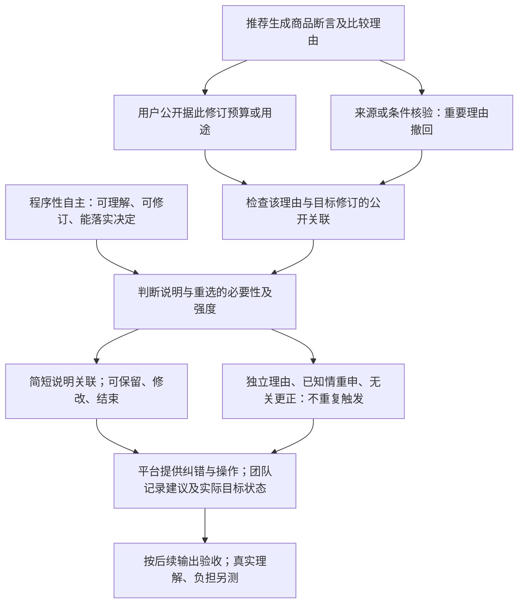

# AI导购纠错与目标重审：研究与论证方案

后续增补：针对本创新点的新模型已实际运行，见[仿真结果与创新点修订](simulation_goal_repair_20261028/04_%E7%BB%93%E6%9E%9C%E6%8A%A5%E5%91%8A%E4%B8%8E%E5%88%9B%E6%96%B0%E7%82%B9%E4%BF%AE%E8%AE%A2.md)。原E2设计仍未运行；下文“未运行仿真”保留该阶段状态。新增模型提供条件机制及边界，不提供真人自主性效果或新算法优势。

版本：2026-10-28整合审阅版。本文承接原A—I方案、三次手机探索材料、近邻研究续查和桌面元宝预试，统一当前推荐方向。交付范围为研究方案、证据与写作提纲，最终题目和贡献强度由作者审阅。

**一句话研究问题：AI撤回一个重要购买理由后，什么时候应提醒消费者重新考虑据此提高的预算，什么时候应接受消费者的新理由、停止追问？**

研究对象为中国成年消费者以中文建议型AI助手选购一只iPhone 15充电器。原预算150元，已有可用USB-C至USB-C线，日常单设备充电。当前推荐贡献是：把程序性自主落实为理由撤回后的处理判准，区分信息更正、评价性建议、目标改写及对后续选择的响应。它允许有理由的升级与委托，并限制重复确认。

## A. 正式评分—论证—证据—交付物

2026-10-28复核[官方通知](https://www.aicomp.cn/notice/notice-3/3921.html)及[赛程调整](https://www.aicomp.cn/notice/notice-3/5435.html)。官方附件1评分表见PDF4—6页，提交要求见PDF3页；附件2提供报告结构。报名缴费与作品截止均为2026年10月30日20:00，北京时间。

|正式评分|需要呈现的论证|所需证据与当前覆盖|具体交付物|
|---|---|---|---|
|问题聚焦与创新价值20|理由撤回为何可能影响目标地位；相对元偏好、反思和再确认增加哪一步|近邻全文指定章节与强基线比较已有；独立的新理论增量仍待论证|C节路径比较、D节命题及反例；[强基线比较](%E9%A2%84%E8%AF%95%E5%90%8E%E7%BB%A7%E7%BB%AD%E5%88%86%E6%9E%90_%E5%88%9B%E6%96%B0%E5%A2%9E%E9%87%8F%E4%B8%8E%E5%BC%BA%E5%9F%BA%E7%BA%BF%E6%AF%94%E8%BE%83.md)|
|需求洞察与背景分析10|搜索便利与事实核验、购买理由形成之间的冲突|三次手机探索材料、商品核验及文献；普通消费者需求分布与负担缺真人证据|E节任务与资料身份；商品来源记录；增强版用户研究设计|
|理论深度与框架构建20|主理论怎样决定定义、提醒条件及不干预边界|八篇方法拆解、相关近邻、四个主张及规范桥梁|B与D；逻辑图；六类边界情形|
|研究过程与学术规范15|取得、阅读、构造、执行与推断各自可追溯|读取与检索账、执行前协议、完整9轮、环境、时间与文件校验已有|[方法矩阵](B_%E6%A0%B8%E5%BF%83%E8%AE%BA%E6%96%87%E8%AE%BA%E8%AF%81%E6%96%B9%E6%B3%95%E7%9F%A9%E9%98%B5.md)、[预试记录](evidence/%E5%85%83%E5%AE%9D%E6%A1%8C%E9%9D%A2%E7%89%88%E9%A2%84%E8%AF%95_%E5%AE%8C%E6%95%B4%E5%AF%B9%E8%AF%9D.md)、论点证据台账|
|结论成效与实用价值15|由风险机制推导谁在何时采取什么措施|责任、触发、验收及纠错方案已有；实际用户收益尚未测量|F节设计／审计清单及可用操作|
|反思局限与未来展望10|独立理由、委托、负担和退出怎样改变最终规则|正面预试、反例、替代解释与证据范围|D、E、F的适用边界和增强研究|
|材料完整与规范附加分10|评审能从正文判断复查原文与过程；提交满足规范|研究材料可追溯；正式报告、PPT、查重、网盘与最终匿名尚待制作|G—I及附录安排|

优先完成能支撑主张的证据、推理与反例。MATLAB的价值取决于它能否解释关键机制，评分表没有固定的MATLAB专项加分。本方案分析证据覆盖，不预测分数。

## B. 材料状态与“作者怎样证明”

### B1. 全部读取状态的入口

21项原论文及用户汇总、目录和逐篇卡的完整状态见[原方案B1](%E7%A0%94%E7%A9%B6%E4%B8%8E%E8%AE%BA%E8%AF%81%E6%96%B9%E6%A1%88_A-I.md)。原八篇论证方法矩阵保存逐篇书目、实际章节／页码、规范前提、方法、推理、证据与反例。新增R1—R10、V1—V5按[理由纠错近邻记录](%E7%90%86%E7%94%B1%E6%A0%B8%E9%AA%8C%E4%B8%8E%E7%BA%A0%E9%94%99_%E8%BF%91%E9%82%BB%E7%A0%94%E7%A9%B6%E6%A0%B8%E5%AF%B9.md)和[创新续查记录](%E5%88%9B%E6%96%B0%E7%BB%AD%E6%9F%A5_%E6%96%87%E7%8C%AE%E6%96%B9%E6%B3%95%E4%B8%8E%E8%AF%BB%E5%8F%96%E8%AE%B0%E5%BD%95.md)分别登记，不自动升级成精读。

|资料组|取得与阅读状态|在本方案中的用途|
|---|---|---|
|用户文献汇总、目录、21卡|已核对；15个原本地PDF经文件解析核验|确认范围、版本和材料来源|
|八篇核心论文|全部论证正文已机器辅助精读；文后引文未逐项外查|规范推理、概念贡献和方法迁移|
|C4/C5/I2/I5/N3/N7/N8|取得正文并读指定部分|替代品、负担、平台责任与解释边界|
|C1/N1|摘要或书目；本轮仍无可读全文|近邻线索；补证优先于评价全文方法|
|N4/N5|有在线正文渠道，读指定章节|补充机制和披露边界；保留部分阅读身份|
|I6/S2|卡片、书目或此前节选|概念线索，不承担全文方法评价|
|新增R/V近邻|多数部分阅读；V2三页论证正文读完|限定创新强度；读取范围见上述日志|
|官方通知与两个附件|正文及附件已核；本轮再核通知和赛程|评分、结构与提交要求|
|三次手机探索及后续纠错文本|用户提供；截图及后续文字分存|真实购物过程线索，提示无据断言与纠错问题|
|桌面元宝预试|实际执行3会话，每会话3轮|真实系统对构造历史的响应；独立保存环境与完整文字|

文献中的作者主张记【原】，本研究重建和比较记【综】，拟提出命题记【新】。取得PDF、提取文本、读取部分与精读论证正文各自登记；AI辅助阅读记录不代表作者本人已读。

### B2. 八篇核心方法如何承接自己的论证

|编号与实际范围|“作者先……再……依据……因此……”的论证重建【综】|本题借鉴与待补步骤|
|---|---|---|
|C2 刘颖、刘佳璇2024；PDF1—17，印刷122—138|先区分机制，再判断相应权益影响，依据类型差异与域外制度比较，因此提出分层本土治理|借类型学，让错误信息、无据升级和退出障碍对应不同措施；聊天机制及中国主体适用另证|
|C3 丁晓东2022；PDF1—20，印刷99—118|先质疑解释权的预设，再比较人类与算法的不透明，依据信任与制度目的，因此重构差异化程序|借规范反思，按情境确定说明和纠错强度；从“解释有限”推不出无需解释|
|I1 Bjørlo等2021；正文PDF1—16|先拆开自主性概念，再综合便利与风险机制，依据跨领域研究，因此提出概念框架和命题|借机制解释，区分便利、感知与实际条件；本题效果仍需证据|
|I3 Brenncke2024；本地正文PDF1—32|先拆解错误剥削条件，再比较竞争规范基准，依据自主性与消费者法的解释力，因此说明某些选择架构为何有错|借竞争解释，评价同一选择的形成条件；域外法律结论不直接成为中国义务|
|I4 Susser等2019；正文1—14、脚注20—22|先比较影响、说服与操纵，再分析数字机制，依据自主判断受干预的方式与思想实验，因此提出操纵评价|借概念分析与反例；认定有意、隐蔽利用须另证，错误信息本身不足以认定操纵|
|N2 Brenncke2024；本地arXiv PDF1—41|先归纳法律材料，再重建自主概念，依据类型与边界案例，因此形成六类中层分析|借中层类型与边界检验；本地PDF页不冒作正式期刊页|
|N6 Prunkl2024；论证正文PDF1—17|先分真实性和行动能力，再用社会影响反例比较，依据AI作用方式，因此分别定位自主风险|借“认可理由／落实决定”的区分；不能从脚本表达直接读出真实心理认可|
|S1 Mathur等2021；论证正文PDF1—25|先比较暗黑模式研究，再区分设计属性与规范标准，依据不同目标与基线，因此提出测量策略|借“先给错误标准再选指标”；按钮数、满意度或更低花费都不自动等同自主性|

互补关系是：I1提出便利与风险，I4/N6澄清评价对象，I3提供规范竞争，C2/N2细化机制，C3/S1连接程序及证据。张力包括I4的隐蔽性定义与I3较宽的剥削分析、持续沟通与负担、选项可用与选择过载。迁移到多轮AI导购，还要证明理由、目标和后续响应在该场景中如何关联；文献结论不能替代这一步。

## C. 三条创新路径与推荐

|候选|最近研究已做到什么|拟增加什么【新】|证据、反例与完成条件|评分关联及成本|
|---|---|---|---|---|
|①重要理由撤回后的目标处理，推荐|V2元偏好和改变认可；R1反思与经验知识；V3交互模式；V5再确认|把某项理由与某次目标修订联系起来，细化提醒、建议、实际改写及停止提醒的条件|需可见理由关联、撤回状态和后续决定；独立理由、已重申、无关小错及退出限制触发；当前可做规范比较|主要关联创新、理论、过程、实用和反思；现有材料最能承接，成本较低|
|②一般质疑与带证据质疑的纠错差异|C3持续沟通，N7/V1质疑与负担|考察纠错是否要求用户先知道答案，区分支持与责任转移|需冻结同一断言及匹配提示；控制字数、信息量和答案注入；普通质疑也可能成功；尚未执行|过程与实用关联强；提示控制和额外采集成本较高|
|③少解释／委托与事实核验责任|N2能力与行使，V3委托，R1负担|区分用户选择少阅读与平台降低关键依据的核验强度|需按重要性讨论核验；消费者接受不确定、低价任务成本及资料缺失是边界|理论、治理和反思适配；与已有原则重合较多，适合作为①的边界|

推荐①，因为问题具体、已有证据可复查，规范推理可在当前窗口完成。③约束方案负担；②作为增强研究。

**相对最近研究的贡献表述供审阅**：将AI导购的重要理由撤回与其曾支持的目标修订联系起来，提出有条件的关联说明与重选判准，并用独立理由、知情重申和退出要求限定干预范围。

公开中英文定向检索的日期、词组、平台及范围已记入三个检索／近邻日志；本次延续已有范围，未新增数据库内系统检索。[强基线逐项比较](%E9%A2%84%E8%AF%95%E5%90%8E%E7%BB%A7%E7%BB%AD%E5%88%86%E6%9E%90_%E5%88%9B%E6%96%B0%E5%A2%9E%E9%87%8F%E4%B8%8E%E5%BC%BA%E5%9F%BA%E7%BA%BF%E6%AF%94%E8%BE%83.md)表明，元偏好、苏格拉底式反思及再确认已有主要规范基础。当前贡献按“有条件规范推导与审计操作化”呈现；首创或理论突破仍无充分依据。

## D. 完整论证链与逻辑图

### D1. 场景和概念

对象限定为中国成年消费者、中文建议型助手、iPhone 15及一只充电器。初始预算150元，已有可用USB-C至USB-C线，日常单设备充电，无初始笔记本或多设备同时充电需求。真实商品比较须另冻结精确型号、协议档位、价格取得条件、可得性和来源日期。构造案例甲79元、乙179元，不对应真实报价。

|概念|本题定义与判断用途|
|---|---|
|知情选择|把握对任务重要的事实、不确定性和取舍，并据此选择；披露出现与理解分开|
|规范自主性|有评价、认可和修订购买理由的机会，并能落实决定；允许合理升级、委托和省略细查|
|感知自主性|本人觉得自愿和可控的程度，需独立自报|
|满意度|对商品或交互的事后评价，不能代替自主条件|
|说服|提供可识别、可评价的理由以改变选择；评价理由及交互条件|
|操纵|沿I4采用有意、隐蔽利用决策脆弱性的工作定义；另列不满足此定义的自主限制|

另分四个层次：断言真假、证据支持程度、该断言对用户理由的作用、当前目标的有效范围。“没有证据更安全”不等于证明安全性完全相同；重要理由失去支持也不等于新目标自动无效。

主要伦理理论是程序性自主；以N6的真实性／行动能力区分落实。辅助仅采用价值敏感设计，把价值转成要求、操作和验收。理论决定：首先处理重要事实及理由关联，然后保障保留、修改和结束；消费者已知情表达的外观偏好不因价格较高被否定；负担与隐私成本约束程序强度。

### D2. 核心问题、中心论点与子论点

核心问题见首页。**中心论点【新】**：重要事实理由失去支持、与目标修订存在公开联系、决定仍可调整时，建议型助手应说明相关影响并保留重选机会。它可以给出有依据的预算建议；实际改写目标须有相应依据。独立理由、知情重申和明确退出分别限制再次提醒。

|递进子论点|主张—规范前提|事实证据—推理桥梁|最强反对—回应—成立边界|
|---|---|---|---|
|L1 最新目标与形成条件可区分|同样预算200元，其理由历史可能不同；程序性自主重视形成及修订机会|N6/V2/V3概念、T1—T3给定背景；若用户明示主要因某优势升级，撤回该优势与其认可条件有关|反对：这是猜测真实动机。回应：只分析公开关联，不推断隐秘偏好；关联不清时记未知|
|L2 纠错有时应触及目标选择|针对性说明和重选机会有规范理由；消费者应能据重要新信息调整|R1经验知识、C3程序、V5再确认；从商品事实到目标选择的桥梁是重要性及明示依赖，而非金额本身|反对：一般再确认足以解释。回应：承认来源，贡献限于触发和范围的细化；决定已不可调整或更正无关时收窄|
|L3 建议与替人决定应分开|可以推荐省钱，也可以接受外观升级；最终决定地位属于消费者|T1建议甲且保留乙入口，T2/T3按颜色建议乙，随后均接受重申；便宜推荐兼容150和200，无法据此推定后台改写|反对：这样会保留错误影响。回应：说明影响、提供实际修改；独立或已知情认可后尊重决定，真实理解需另测|
|L4 修复强度与负担相称|简短提示、按需展开和可结束；支持自主也允许少反思|V1负担、R1摩擦、V3委托；增加步骤只有在支持相关选择时才有理由|反对：提示少遗漏风险，提示多阻碍便利。回应：按重要性触发，重申后不重复，退出优先；效果与阈值需真人证据|

这些桥梁是规范论证，需要由原则、竞争解释和反例辩护。预试响应展示条件区分的实例；规范结论不从响应数量或模型自称“尊重”中推出。

### D3. 技术机制—伦理判断—治理

“披露不足”只说明某种措施不能覆盖全部条件；它不能单独证明本方案充分。图中措施支持一组程序条件，价格结果、信息准确性、理解与实施能力仍分别检查。

## E. 案例、真实响应与可选MATLAB

### E1. 四类材料分别能支持什么

|身份|材料与状态|能支持什么|
|---|---|---|
|FACT 商品事实|Apple官方快充说明；用户商品页及E01230型号截图；准确范围见商品核验记录|限定兼容、页面宣称和核验缺口；截图价格按条件和时间记录，不外推当前售价|
|EXP 用户探索|三次手机对话及后续文字，记录版本／日期信息不全|购物中具体断言与纠错线索；不合并为受试者样本或可比重复|
|CASE 规范案例|六类理由与目标情形；未执行部分保持设计身份|比较提醒、恢复预算、继续升级等处理是否符合原则|
|PILOT 系统响应|元宝Windows 2.90.0.607，“快速回答”；2026-10-28约07:21—07:31；3新会话×3轮|真实系统如何回应给定背景、知情重申和结束；底层模型和记忆设置未知|
|SIM 合成仿真|变量、公式和验证设计已写，未运行|将来检验注意与操作成本机制，不直接测完整自主性|

手机材料中的0.87%故障率、20分钟36℃等已撤回或缺可核出处，不进入商品比较依据。“更安全”的真假与支持状态分开。甲乙预试中错误历史由研究者提供，不是元宝本轮自然产生错误。

### E2. 已执行预试及其作用

|条件|首轮实际表现|后续共同指令的响应|
|---|---|---|
|T1 主要为已撤回的安全理由升级，原无颜色偏好|建议甲，写“恢复原预算”，同时提供保留乙的入口|接受知情因颜色保留200元；末轮停止新推荐|
|T2 原先已明确独立为蓝色加价|建议乙，承认外观价值|接受明确选择；末轮停止新推荐|
|T3 撤回后已经知情重申因蓝色保留预算|建议乙，未要求再次确认|接受明确选择；末轮停止新推荐|

执行前协议、全部实际提示和回应、逐轮UTC时间、文件校验已保存；本轮附匿名文字摘录与已填台账。固定顺序、每条件一次、措辞长度不同、新会话记忆未知且无真人心理测量，结果定位为有限预试。T1“恢复预算”是可见建议措辞；后台目标是否改写未知。历史建议入口与结束后新增推荐分开判断。

### E3. 承接原要求的商业披露×选择控制2×2（研究设计）

商业披露D有／无，选择控制C有／无，形成D0C0、D1C0、D0C1、D1C1。四组共享完全相同的任务、商品事实、商业排序偏向、最大交互轮数及长度控制目标。商业偏向由CASE明确设定，不能从元宝提供商品链接推定真实佣金关系。

|操纵因素|具体实现|理论依据与可观察检查|
|---|---|---|
|D商业关系披露|有组简洁显示赞助／佣金关系及影响范围；无组不显示；保留等长中性说明以控制阅读量|知情条件；检查读到与理解分离，披露不直接消除偏向|
|C查看替代|可调用预算内适配替代，附与当前任务相关的取舍；无组仍可自然语言请求，记录是否实现|有意义选择机会；检查替代是否真实可得，数量不等于质量|
|C重设目标|允许改预算或用途并显示当前比较范围|自主理由可修订；检查表达、应答、后续遵从分开|
|C质疑排序|允许询问为何某商品靠前、证据适配及商业因素|可评价、可质疑；检查来源支持及重新比较|
|C拒绝继续|一句结束或可用结束入口|允许不购买及不行使反思；检查后续新增输出和实际退出摩擦|

本轮T1—T3只改变理由背景，不是上述2×2，也未操纵商业信息。正式案例比较可固定人工编排的回复版本；真实系统审计则须记录无法控制的事实更新、长度及后台差异。两者分别说明规范区分与系统表现，组间真人效果需另行研究。

如继续真实审计，先新增协议，冻结平台版本／模式、日期、任务全文、提示、重复次数、独立会话与上下文保存方式。当前优先保持已完成记录，不为追求负面结果追加采集。

### E4. MATLAB判断及设计交付

当前主论点依靠规范推理、明确理由历史与后续响应；MATLAB无法补上消费者真实理解或相对近邻的新颖性。因此最低版不运行仿真。[完整可选设计](E2_MATLAB%E6%9C%BA%E5%88%B6%E4%BB%BF%E7%9C%9F%E8%AE%BE%E8%AE%A1.md)保留变量、公式、伪代码、图表与运行检查，作为增强研究。

仿真若实施，比较同一D×C四组：属性与兼容约束、任务权重和预算、平台商业收益与排序权重、有限注意、披露阅读／理解、操作成本及目标更新分别建模。用任务效用、商业项和有限阅读形成排序与选择，披露仅改变商业信息识别及处理成本，控制仅改变可调用操作及实现条件；不向公式直接加入“自主性加分”。

|观测及图表|待检验机制|削弱命题的结果|
|---|---|---|
|四组任务及兼容满足、未获认可预算偏离图|操作是否帮助落实当前目标|控制无效或更差；结果只在一个强假设下出现|
|商业偏向×披露理解的敏感性图|披露理解与排序影响是否分离|零偏向仍出现机械优势；未理解却被设定必然纠偏|
|替代品可见、目标修正及拒绝成本图|机会是否实际可用|入口增加但合格替代不出现，或步骤成本反而上升|
|质量—时间／注意负担前沿|保护是否存在成本及反转边界|高成本区域全面劣于简化方案，或优越性完全来自人为低估成本|

参数逐个标记文献概念支持、经验测量或研究者假设。当前主要数值是机制假设；含零商业偏向、披露未理解、信息过载及不同合理行为规则。若随机重复，用种子20261028及配对商品／用户输入；先按蒙特卡洛误差稳定性确定次数，模拟次数不称受试者人数。真实运行与验证完成后才能报告数值。

## F. 治理清单、反例与伦理反思

|风险机制／理论依据|责任主体与触发|措施与验收|成本、新风险及纠错|
|---|---|---|---|
|重要断言缺支持，妨碍知情判断|商家提供资料；平台／团队使用比较理由时核验|匹配精确型号、来源和测试条件；失配标不确定并更新比较|核验成本；按任务重要性分层，商家及用户可提交更正|
|理由撤回后目标来源被遗漏，影响自主修订|团队在公开关联、重要且仍可调整时触发|说明关联，保留／修改／结束可用；不把建议说成已生效目标|动机误识别；允许“我不是因为这个”，纠正理由关联|
|独立理由被否定，或不断强迫确认|团队收到独立理由、知情重申或委托要求|承接表达，不对同一信息反复提问；追加重要新信息另记|可能漏掉误解；用明确理解证据而非假定消费者无能力|
|合格替代被遮蔽、重排不起作用|平台负责候选可得性；团队负责入口与执行|预算内适配替代及取舍可查；修改后输出可复核|信息过载；默认少量关键比较，按需展开|
|商业关系影响判断但不可识别|平台／商家分别确认实际关系与展示角色|存在应披露关系时简洁说明；质疑排序可得到相关答复|披露疲劳或误增信任；不把披露等同公平与理解|
|退出摩擦，限制不购买|平台／团队收到停止指令|后续不新增商品推荐或追问，退出渠道可用|历史入口误判；分开检查正文、历史控件及应用退出|
|记录理由造成隐私与数字能力负担|平台制定保存范围，团队落实|任务内最少记录、来源可追溯、可删除；提供简洁文字操作|追踪与长期画像风险；错误关联可更正，未授权长期写入不作为默认需要|

关键反例一：用户知道商业关系，理解安全优势未被证实，仍因蓝色认可升级。框架支持保留200元与乙，不把多花钱当失误。T2/T3及后续重申是符合这一方向的响应实例。

关键反例二：来源、按钮和追问过多造成负担。措施改成简短关联说明、按需展开、不重复触发与可直接结束；更多步骤是否值得由任务和用户证据判断。消费者选择少阅读或委托，不等于允许系统编造关键依据。

本土治理沿用原方案F3已核官方文本：消费者权益保护法、实施条例、个人信息保护法、算法推荐管理规定及互联网广告管理办法，逐项辨认经营者／平台角色、算法和广告适用条件。知情、比较及拒绝提供法律基础；本方案具体的目标关联、提示频率和验收为伦理操作化。低价建议不一律视为对个人权益有重大影响的自动化决定。

本研究的经验限制集中于E2；治理权衡在本表中实际改变触发、记录与展示。真人研究增强时，再测数字能力差异、理解、认可、退出与隐私成本。

## G. 题目、简介及报告提纲

推荐题目：**AI导购纠错与目标重审**，供作者审阅。独立简介草案见[简介文件](%E7%A0%94%E7%A9%B6%E7%AE%80%E4%BB%8B_%E5%AE%A1%E9%98%85%E7%A8%BF.txt)，按≤300字核对，与当前已完成范围一致。

|报告部分|需要回答的具体问题|承接证据／图表|
|---|---|---|
|摘要、关键词、引言|为什么事实改正后仍要讨论目标；为何选充电器|任务范围、手机探索线索及问题图；简介与摘要分别处理|
|1 背景与最近研究|便利与自主冲突；别人怎样证明，已做到哪里|B的方法链、读取账、R/V近邻及检索范围|
|2 概念和理论|为何选程序性自主；合理升级如何成立|六概念、证据／真假／理由／目标四层区分、规范前提|
|3 研究方法与材料|文献、CASE、手机探索、桌面响应各能证明什么|执行前协议、环境、完整记录、匿名摘录及材料身份表|
|4 规范论证与案例分析|L1—L4能否经受强基线及反例|D论证表、T1—T3结果、六类边界表、主张证据台账|
|5 治理设计与验收|谁在何时做什么；怎样知道措施可用|F清单、纠错流程图；法律与伦理分述|
|6 讨论、局限与展望|哪些条件限制规则；真实用户和其他平台还需测什么|成功表现、未知后台、负担反例、增强方案|
|结论、参考文献、附录|回答研究问题，提供可复查依据|有限结论；原文定位、检索读取账、匿名全对话、AI协助说明、查重报告|

写作时按“借鉴的方法—增加的判断—检验与反例—适用条件”组织。V2/R1等近邻进入正文贡献比较，原八篇完整矩阵可放附录，避免正文变成观点清单。正式篇幅依据内容和版式决定，不虚构主办方字数要求。

答辩可按8页准备：问题与任务；已有研究及增量；理论和概念；方法与资料身份；预试及边界；核心论证与反例；治理验收；局限与后续。每页绑定上述一项证据，研究设计图不能标成实证结果。本轮交付提纲，尚无PPT文件。

## H. 最小可完成版与增强顺序

|顺序|最小版动作|完成标准／状态|
|---|---|---|
|1|统一推荐问题、主张和证据身份|本整合稿已形成，待作者审阅最终题目及贡献强度|
|2|填写论点证据台账，导出桌面预试匿名文字|本轮生成并检查与原记录对应；原始私有记录仍保留|
|3|逐项检查推理、强反对和边界|D、F及强基线表已给；分清需要规范辩护与需要实证资料的部分|
|4|依G编写正式报告，再做图表与答辩文件|这是下一阶段；当前不直接代写整篇论文|
|5|统一引文、材料身份及AI协助说明|以实际阅读和使用范围为准，作者核读关键段落|
|6|知网检测、附录、PDF、PPT与匿名打包|正式文件形成后执行；状态见I|
|7|检查网盘可访问性并在截止前提交|建议10月30日18:00前完成内部验包，官方截止20:00；时间为北京时间|

增强版按明确缺口选择：先补最近中文全文及V1/V3/R1相关引文，再按新协议扩展其他理由情形或匹配质疑审计；需要主张理解／认可／负担收益时开展真人研究；需要说明注意与操作成本机制时才运行MATLAB。扩展不改变已完成预试的原协议和材料身份。

## I. 正式提交核对

依据官方附件1第3页及附件2第4页。当前是可审阅研究包；本轮未执行报名或上传，正式参赛PDF/PPT及查重尚未形成。

|材料|验收条件|当前状态|
|---|---|---|
|题目／简介|题目≤20字；简介≤300字且准确反映成果|本轮草案已计数，待作者定稿|
|报告PDF|≤10M；图表、引文、参考文献和附录齐备；能正常打开|尚未生成；验包采用<10,000,000字节并留余量|
|知网查重|全文检测不含附录；重复率严格低于20%；报告放附录，检测版本对应正文|未检测，不填数值|
|答辩PPT|内容覆盖问题、方法、贡献、应用与边界，文件可播放|本轮只有提纲|
|补充材料|脚本、记录、表格与必要代码；按团队编号—赛题—作品—材料命名；百度网盘永久有效链接及自动提取码|研究材料已整理；团队编号未知，网盘未上传|
|内容匿名|正文、附录、截图、文件名、图表、二维码无参赛个人／学校／学院／导师识别信息|本轮导出匿名文字；既有工作稿含本机路径，整体尚非可提交匿名版|
|隐藏身份|文档属性、PDF元数据、PPT母版与备注、批注修订、分享者资料和链接权限均检查|待正式文件形成后检查；正常学术作者与出处保留|
|完整性／访问|正文引用能对应补充材料；未登录视角打开分享，文件不缺；法律与事实链接可复查|本轮本地链接及文字一致性检查；正式网盘检查待做|

补充材料优先提供自己的协议、匿名记录和来源定位。受版权约束论文提供合法链接与页码，不默认整套转载。原始私有记录与对外材料分别保存。

## 本轮配套文件

- [主张—证据台账（已填）](%E8%AE%BA%E7%82%B9%E8%AF%81%E6%8D%AE%E5%8F%B0%E8%B4%A6_%E5%B7%B2%E5%A1%AB.csv)：支持层次、限制与补证动作。
- [桌面预试匿名文字](evidence/%E5%85%83%E5%AE%9D%E6%A1%8C%E9%9D%A2%E7%89%88%E9%A2%84%E8%AF%95_%E5%8C%BF%E5%90%8D%E6%96%87%E5%AD%97%E6%91%98%E5%BD%95.md)：全部实际提示和主回答，去除私有会话标识。
- [元宝预试结果与论证修订](%E5%85%83%E5%AE%9D%E6%A1%8C%E9%9D%A2%E7%89%88%E9%A2%84%E8%AF%95_%E7%BB%93%E6%9E%9C%E4%B8%8E%E8%AE%BA%E8%AF%81%E4%BF%AE%E8%AE%A2.md)：环境、原始完整记录入口及T1判读。
- [强基线比较](%E9%A2%84%E8%AF%95%E5%90%8E%E7%BB%A7%E7%BB%AD%E5%88%86%E6%9E%90_%E5%88%9B%E6%96%B0%E5%A2%9E%E9%87%8F%E4%B8%8E%E5%BC%BA%E5%9F%BA%E7%BA%BF%E6%AF%94%E8%BE%83.md)：最近研究与增量边界。
- [原始A—I方案](%E7%A0%94%E7%A9%B6%E4%B8%8E%E8%AE%BA%E8%AF%81%E6%96%B9%E6%A1%88_A-I.md)：保留原读取账、法律来源、2×2及仿真设计历史。

本研究使用academic-research-suite辅助文献方法拆解与推理检查，使用anti-defensive-writing压缩重复说明。作者审阅时优先核对中心论点、关键原文定位、证据身份及贡献强度；本整合稿提供具体可评的方案。
