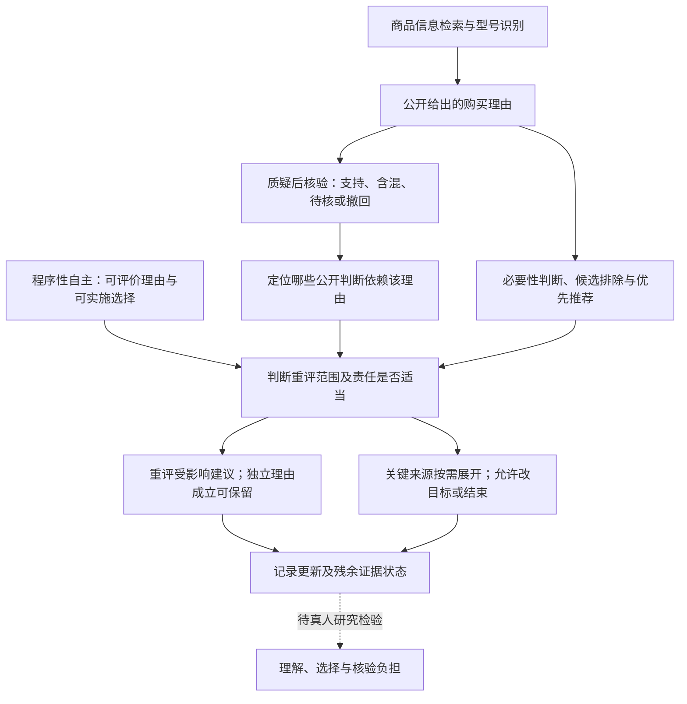

# 从三次试跑推进到自己的论证方案

日期：2026-10-28（Asia/Shanghai）。供作者审阅的研究与论证方案，尚未定稿选题或撰写整篇参赛报告。沿用academic-research-suite的论证重建与来源核验，使用anti-defensive-writing整理表达。

## 先看这段

三次材料显示：助手按最终要求给出了预算内标价；收到针对性质疑后，分别撤回故障率、澄清充电时间、撤回温度数字，并调整购买理由。我们应保留这些成功表现。

现在最有材料支持的研究任务是：**检查购买理由被撤回以后，相关的比较和推荐怎样处理才合理。**例如，原先以“最凉”为理由推荐某款，撤回温度证据后，就应重评“温控最好”这个判断；如果另有可靠、相关的价格或兼容理由，仍可保留该商品。

建议候选研究问题：**AI购物助手撤回一项重要购买理由后，应如何重评相关推荐，同时保留消费者自己的取舍？**具体增量待最近研究与反例检验；作者仍可保留原候选方向。

## 1. 七项评分要求对应到当前证据

正式评分权重沿用原方案及官方附件；此表报告证据覆盖，不预测得分。

|评分项|需要证明什么|已有材料及本轮交付|关键缺口与补证动作|
|---|---|---|---|
|问题聚焦与创新价值20|问题具体，贡献超出准确性、披露或一般纠错常识|预算内iPhone15充电器任务；三条路径比较；新增R6—R10近邻核对|把拟判准与普通事实检查、已有解释修正逐例对照；判断不增加区分时降低创新表述|
|需求洞察与背景分析10|消费者在真实任务中遇到什么困难|三条探索性对话及后续撤回/澄清链；价格与用途约束|不是需求普遍性调查；SKU、版本、原来源入口及用户实际理解未齐，按缺项报告|
|理论深度与框架构建20|从自主性前提推到为何、何时要求重评|程序性自主主理论；四个递进子论点、反例和逻辑图|论证“实质购买理由”的边界与比例性，避免把任意小错都等同自主受损|
|研究过程与学术规范15|材料、读到哪里、怎样判断均能核验|原八篇精读矩阵；本轮四篇补充全文已取得、部分阅读；检索和获取日志、原图与转贴分开|原图采集时间/模型不全；补充阅读不冒充全文精读；单次AI辅助分析不冒充多研究者一致性|
|结论成效与实用价值15|判准能转化为设计和审计操作|构造案例文本、纠错验收及主体责任清单|尚无用户效果或干预收益数据；当前成果为可执行方案及案例判断，不宣称效果已验证|
|反思局限与未来展望10|反例实际改变方案|同款仍合理、合理升级、过载、跳过核验、错误不重要等边界|来源呈现会否增加负担需另行用户研究；不能用模拟用户替代真人理解|
|材料完整与规范附加10|材料齐全、匿名、可复核|原A—I方案与提交核对、来源和工作记录|报告PDF、简介、查重附录、PPT及匿名导出仍属提交阶段工作，不能把设计文档当已提交作品|

MATLAB暂无优先执行价值：当前最重要的缺口是来源适用性与规范判准，仿真不能补上。原仿真设计保留为未运行备选。

## 2. 三次材料的案例分析

|材料|值得保留的表现|依据问题及后续|目前可以说什么|
|---|---|---|---|
|试跑1|最终标价遵从150元限制|0.87%未交付原始统计，后续撤回并改写原装优势；E-Marker的统一必要条件另经TI资料核对不成立|指定故障率理由已撤回；其他理由分别核验，未测实际购买影响|
|试跑2|最终预算执行；受邀比较贵方案时说明当前未必需要|“20W只能到50%左右”缺时间条件；后续补充约30分钟并调整20W/30W取舍|有可见澄清与理由更新；官方快充条件不能代替所有峰值/速度差断言|
|试跑3|最终预算执行；预算内升级明确非必需|撤回20分钟36℃，删除最凉卖点，仍保留商品；新增42.8℃可找到专栏文字，但该页列双口、回复称单C，型号无法对应|相关优势已重评；产品保留并非失败；替代理由的证据匹配尚未完成|

原句、来源和状态详见[关键断言表](%E4%B8%89%E6%AC%A1%E8%AF%95%E8%B7%91_%E5%85%B3%E9%94%AE%E6%96%AD%E8%A8%80%E4%B8%8E%E7%BA%A0%E9%94%99%E8%AF%81%E6%8D%AE%E8%A1%A8.md)。42.8℃页面仅证明数字在公开文章出现，未被确认为助手原引用，也未升级为当前商品的已核测试事实。

后续商品核对已推进到[型号E01230、商品号100233802459](evidence/%E5%95%86%E5%93%81%E6%A0%B8%E9%AA%8C002_E01230_%E5%8F%82%E6%95%B0%E5%8F%8A%E6%9D%A5%E6%BA%90%E6%A0%B8%E5%AF%B9.md)。型号来自用户参数截图，不能自动证明折叠插脚、协议、CCC有效证书或温控优势；缺证项目继续按待核处理，不阻塞现有规范案例方案。

这些是三条用户提供的探索性材料，后续质疑来自研究协助中的定向追问。完整平台导出、会话独立性、采集日期及模型版本未齐；不估计平台总体错误率、纠错率或操纵率。后台排序机制、消费者理解及真实选择变化均未观测。

## 3. 理论怎样决定概念和判断

主理论只采用**程序性自主**：关注消费者是否有机会理解、评价与修订购买理由，并实施自己认可的选择。辅助采用**价值敏感设计**，用于把这一要求转成可观察的产品责任，沿用原方案而不另增伦理理论。

|概念|本方案的用法|对案例的实际影响|
|---|---|---|
|知情选择|能接触并理解与本任务重要取舍相关、适用范围清楚的信息|有链接、承认错误、给出规格，都需另看是否支持这个型号及判断|
|规范意义的自主性|具备按自己可认可的理由决定与行动的机会；不要求每次穷尽核验|合理省事、自愿保留原商品或提高预算都可成立；需要看认可过程和交互条件|
|感知自主性|用户报告的控制感|需真人报告；三次截图不能测出，也不代替规范判断|
|满意度|用户对结果或过程的评价|满意可能与理由质量不同，不能单独证明选择条件充分|
|说服|向消费者提供其可考虑、质疑的购买理由|有理由的升级比较可以正当，不以价格上升直接定错|
|操纵|本方案沿I4采用有意且隐蔽影响等条件较强的概念|现有材料缺意图、隐蔽策略和商业关系证据，先判断信息及纠错，不给操纵标签|

主理论决定三项优先序：先避免无据的重要理由继续左右比较；再提供可用、可拒绝的针对性纠错；最后按消费者需要展开更多资料。默认把所有来源堆给消费者不符合比例性要求。

## 4. 借鉴了什么论证方法

原八篇核心精读状态不变，页码与完整拆解见[B矩阵](B_%E6%A0%B8%E5%BF%83%E8%AE%BA%E6%96%87%E8%AE%BA%E8%AF%81%E6%96%B9%E6%B3%95%E7%9F%A9%E9%98%B5.md)。这里抽取推进本切口的具体步骤。

|已有论文怎样证明|借鉴的方法|本题新增哪一步|迁移需什么证据|
|---|---|---|---|
|C3丁晓东先拆解释权四维，再用解释成本与失效反例，依据沟通信任推到动态程序（印刷101—117页）|维度分析、反例、由规范原则配置程序|把“有回复”细分为指定断言处理、受影响比较重评与替代依据状态|逐轮原文、质疑内容、变化位置；不能只统计道歉次数|
|N2 Brenncke先从信息产生购买理由重建自主，再区分能力/行使，依据规则归纳侵害类型（本地PDF17—39页）|概念重建与规范类型学|限定为对任务有实质作用的理由，并允许消费者不继续比较|该理由如何支持必要性、排除或优先推荐；轻微修辞另列|
|N6 Prunkl先拆理由归属与行动能力，再用案例和反例说明治理应有针对性（PDF7—16页）|概念分析、机制解释、边界反例|把预算操作成功与购买理由可评价分别观察，并保留自愿认可升级|用户目标与表达记录；实际理由认可不能由AI代演推定|
|S1 Mathur等先比较定义和实例，再依据规范目标推导指标、基线及阈值（本地预印本19—25页）|规范目标到方法的推导、控制案例比较|设计“同一商品仍可推荐”的反例，避免以换商品或更多链接机械判成功|相同目录和任务的成对案例、普通事实检查基线、负担记录|
|R6/R8分别用来源支持、逐断言事实一致性评价推荐解释|来源对照、断言拆解与实证比较|把型号/条件匹配接到公开购买理由的依赖范围；断言拆解本身不作原创|原始规格/测评，而非把评论对齐自动当产品客观真值|
|R7用规划—修正—反思迭代优化解释；R9把正确性与引文支持分开评估|迭代检查、分别评价解释维度|评价纠错后公开比较是否仍依赖被撤回依据，不要求断言后台真实因果链|原始依据、完整公开对话；要区别于已有解释修正而非重复命名|

R6—R9均只按已读部分使用，方法重建与阅读定位见[近邻核对](%E7%90%86%E7%94%B1%E6%A0%B8%E9%AA%8C%E4%B8%8E%E7%BA%A0%E9%94%99_%E8%BF%91%E9%82%BB%E7%A0%94%E7%A9%B6%E6%A0%B8%E5%AF%B9.md)。信念依赖修订也是早已有的技术思想；本题不主张发明新更新算法。

## 5. 三条候选路径与推荐

|路径|最近研究已经做到什么|拟增加的具体判断|证据、反例及完成条件|评分关联与成本|
|---|---|---|---|---|
|①关键理由的来源适用性|R6事实性解释、R8逐断言评价、R9引文支持；已有可验证性方法|按任务作用区分关键理由，核型号/条件是否可迁移到当前比较|需精确SKU及原始证据；若已有方法逐例给出相同区分，增量限为本土审计操作化|问题/规范/过程/实用；成本较低，但原创理论空间有限|
|②撤回依据后的推荐重评（建议）|C3持续沟通、R7解释修正、R10理由依赖维护已有基础|限定重评受影响的公开优势/排除/排序；有独立支持的商品可保留；替代理由另核|现有三条链可作为例证，另用成对规范案例；若普通事实检查已足够覆盖所有判断，降低创新定位|理论/创新/过程/实用联系清楚；中等成本，可先完成规范与案例方案|
|③核验责任与负担分配|N7批评个人承担监督成本；I5与R1讨论负担/反思；R3摘要含交流成本|按理由重要性和谁控制证据决定主动核验、按需展开与纠错责任|须真人核验时间、理解及数字能力资料；若简单提示同样有效且更省，复杂措施失去理由|需求/价值/反思关联强；经验验证成本较高，适合作增强版|

推荐②作为待审阅的主线：它承接现有真实材料，允许成功与失败两种结果，也容纳同款保留的反例。①用于提供事实判准，③限定治理负担；不把三条拼接本身当创新。若后续核对没有独立判断增量，贡献表述采用“规范依据明确的审计操作化与案例分析”。

## 6. 候选中心论点与四个递进子论点

**中心论点（待审阅）**：当一项公开给出的商品断言实质支持了必要性、排除或优先推荐，而其证据随后被撤回时，保障知情选择要求助手说明受影响的比较范围，并以可核验的独立依据重评相关建议；消费者可以保留原商品或停止进一步核验。实施深度应与任务重要性、证据获取能力和负担相称。这是支持自主的一项有条件要求，不构成自主得到全面保障的充分条件。

### 子论点1：预算执行和重要理由可评价，是可分别检查的条件

- 主张：符合预算的建议仍需审查重要依据；依据有问题也不抹去预算执行的成功。
- 规范前提：自主既关心执行机会，也关心决定所依据理由的评价机会。
- 事实证据：三次最终可见标价均在限制内；指定故障率、时间表述和温度依据发生撤回或澄清。
- 推理桥梁：错误的“必要条件”或无据的“最好”可能改变哪些商品看似可行、值得；其伦理关联来自这种选择作用。
- 最强反对意见：所有工具都有错误，任何小错都上升为自主问题会过度要求。
- 回应：只针对实质影响兼容、预算、必要性或用户明确优先事项的理由；背景措辞与无关小错不等量处理。
- 成立边界：本轮只分析机会条件与可能路径，实际误解、损害和购买变化未测。

### 子论点2：撤回断言后，需要重评其支持的公开判断

- 主张：撤回“温度最低”的证据，应检查“最凉、值得为此多花钱”等依赖判断；并非只删一个数字。
- 规范前提：消费者应能知道哪些购买理由仍可用于当前决定。
- 事实证据：第三次已删除低温优势；第二次澄清时间后调整20W/30W必要性。这些是正面例证。
- 推理桥梁：若前提失去支持而依赖结论继续未经说明地呈现，其支持关系仍有缺口。
- 最强反对意见：重评只是逻辑常识，技术信念维护和解释修正早已实现。
- 回应：承认通用方法已有；本题需证明的增量是具体义务触发、公开依赖范围、保留商品的边界及验收区分，不能以“更新依赖”单独宣称首创。
- 成立边界：只能审查公开论证的支持关系；没有内部日志时，不推断真实排序算法的因果变化。

### 子论点3：推荐保持不变，可以是合理纠错结果

- 主张：判断纠错看依据是否重新成立，不看是否换商品或一律降价。
- 规范前提：消费者可以按自己认可的价格、兼容、体积或售后取舍决定；研究者不替其确定唯一偏好。
- 事实证据：第三次保留倍思并提出其他理由；其余理由仍有核验缺口，当前不直接判为已充分支持。
- 推理桥梁：一个理由撤回不排除其他独立理由；反过来，换一个商品也不保证新理由可靠。
- 最强反对意见：助手可能为同一商品不断编造理由，保持推荐掩盖纠错失败。
- 回应：替代理由须分别有独立支持，匹配SKU与任务；仅换说法而无证据记为“仍待核”，不能宣布完成。
- 成立边界：若唯一实质理由已撤回，优先性必须重评；可并列、暂缓结论或请求相关偏好，不强制跳到另一商品。

### 子论点4：纠错应由控制证据的一方承担适度责任

- 主张：平台应支持重要理由来源与针对性重评，消费者可以按需查看和结束。
- 规范前提：支持自主应提供可用机会，并尊重有限注意及自愿简化决定的权利。
- 事实证据：三次需定向追问后取得指定修正；所贴回复没有原始URL。用户实际花费时间及常见程度尚未测量。
- 推理桥梁：要求用户先独立识别所有错误再自费核验，可能使纠错机会难以使用；平台与商家更能控制证据入口和更新。
- 最强反对意见：全面核验所有话语费用高，更多材料也会让用户更累。
- 回应：按影响选择的重要程度触发；默认简明结论和可展开关键依据，持续争议再升级，不强迫所有人逐条阅读。
- 成立边界：尚未验证这套措施改善理解或节省时间；此效果需要独立研究，不由规范推导保证。

本图展示公开论证链及规范桥梁，不声称还原模型内部推理，也不把“披露不足”推成“重评措施足够保障自主”。

## 7. 怎样检验，哪些部分尚未执行

1. **已有文献与案例分析**：逐句对照三次原材料、纠错文本和主要来源，已经形成；统计单位是断言/会话片段，不是三位消费者。
2. **构造规范对照**：同一任务和商品事实下，比较局部撤回与依赖重评；另比较匹配来源可用与否。文本见[构造案例与审计设计](%E7%BA%A0%E9%94%99%E5%AF%B9%E7%85%A7%E6%A1%88%E4%BE%8B%E4%B8%8E%E5%AE%A1%E8%AE%A1%E8%AE%BE%E8%AE%A1_%E6%9C%AA%E6%89%A7%E8%A1%8C.md)。这是研究者构造材料，未运行真人实验。
3. **正式系统审计增强版**：作者选定方案后另冻结元宝可见版本/路由、日期、记忆设置、脚本、目录和完整记录；逐案例三次可作稳定性探索，重复数须按预试波动再确定，不能当人类样本量。现有三次不能追认成预注册审计。
4. **理解与负担增强版**：另招募中国成年消费者、告知同意并最小化设备/预算信息采集，比较理解题、理由适用性识别、修正操作、时间与退出；没有这类数据，不写自主性提升或显著改善。

原用户要求的“商业关系披露有/无×选择控制有/无”2×2设计继续保留在原A—I方案。它检验披露与控制的独立作用；三次自然记录没有操纵商业关系，不归入四组。本切口新拟的来源×重评对照检验另一问题，二者分开，待作者审阅后确定主设计。

## 8. 由论证转成治理措施

以下是拟议伦理设计/审计要求；具体法定义务及适用条件仍按原方案F3已核官方文本判断，不把所有项目称作现行法律要求。

|风险机制、理论依据|责任主体与触发|具体措施和可观察验收|成本、新风险与纠错渠道|
|---|---|---|---|
|以无据兼容/功率必要条件排除商品；损害可评价理由|产品团队；输出“必须/否则不能”等实质条件|绑定确切设备、SKU和来源；核验发现错误后重筛受影响候选|检索延迟与旧资料；可直接质疑并记录版本，不要求用户先懂协议|
|其他型号测评被用于本款；破坏比较基础|商家提供规格/版本，平台及团队负责匹配；使用比较数字时|来源可展开到原文及型号、环境、负载/时长；不匹配时撤回当前比较|来源入口成本与页面失效；可标待核、换匹配证据，不能补编数值|
|只删数字仍保留唯一依赖优势；纠错机会落空|产品团队；重要依据撤回时|列受影响的优势/排除/排序及处理结果；同款保留需独立理由|过度回溯或把公开解释冒充后台机制；支持更正记录与再次质疑|
|用新无据断言替代旧断言；无法评价保留理由|平台及产品团队；替代理由提出时|逐条标已支持、含混或待核；不得因承认过错误就免检新理由|信息增加；默认只展开关键项，可跳过或结束|
|商业安排不清影响理由权重|平台/商家；实际存在相关合作、广告或佣金时|按已核适用规则披露；伦理上说明它如何影响候选/排序并提供独立比较机会|披露疲劳与商业数据边界；用户可质疑、选替代或投诉；现有三次商业关系未知|
|信息和操作过多，支持变成负担|产品团队；长解释/连续核验时|少量关键取舍、按需来源、简明撤回说明、有效结束；不要求用户答题才能退出|简化遗漏/数字能力差异；提供可选详细说明及可达客服|
|以纠错为由改写用户目标或收集过多数据|平台制定边界、团队落实；要求重设预算/用途时|确认认可范围，允许维持原目标；仅取任务必要信息|确认摩擦与隐私成本；可撤销目标更改、删除非必要信息并停止|

## 9. 题目、提纲与最小完成顺序

候选题目：**《AI导购纠错的自主性条件》**（不超过20字，待作者审阅）。

报告结构及证据：①问题与具体任务（三条实录）；②自主性概念及价值冲突（N2/N6、I1/I5）；③既有方法与增量（C3/S1、R6—R10）；④材料、读取与判准（截图/转贴/原始来源/CASE分标）；⑤案例分析与成对反例（本轮两个对照附件）；⑥设计与审计建议（责任清单）；⑦局限与后续研究（真实理解、成本、版本与商业关系未知）；附录为来源、脚本、读取记录及按正式要求准备的查重材料。

|顺序|最小可完成版|后续增强版|
|---|---|---|
|1，已完成|保存三次材料和指定纠错，区分成功、待核与撤回|补完整导出和可见模型/日期，不补造历史元数据|
|2，已完成至明确缺口|核验重要断言，发现来源型号适用性问题，记录原出处|补精确SKU与来源入口；取不到则收缩产品比较，不拖延规范方案|
|3，本轮已提供方案|把文献方法转成条件性论点与反例，定位近邻，形成CASE文本|用普通事实检查与已有解释修正作更强基线，必要时降低贡献主张|
|4，待作者审阅|选择主问题、判断规则及贡献定位，再冻结报告提纲|批准增强研究后再采正式审计或真人资料|
|5，提交准备|撰写报告、简介≤300字，匿名导出PDF≤10M；知网全文重复率<20%且报告入附录；PPT和补充材料逐项核对|有明确机制问题与参数证据时再做仿真；所有未运行内容继续标设计|

当前先完成研究设计与论证审阅，最终选题、贡献强度和是否执行增强研究由作者决定。阅读完整原方案与本轮附件后再写参赛正文，可避免把探索性观察写成正式实验结论。
